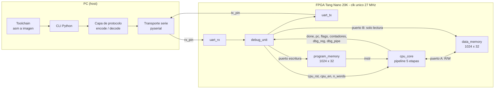
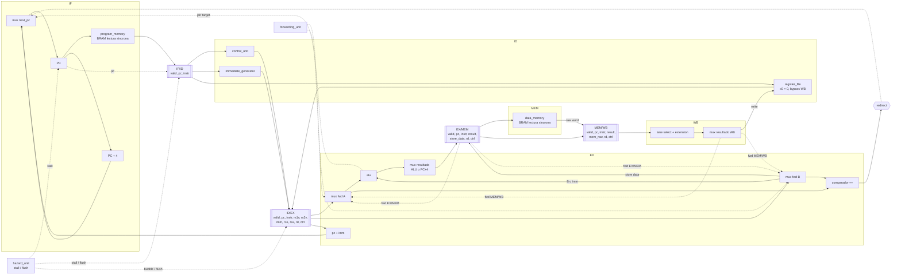
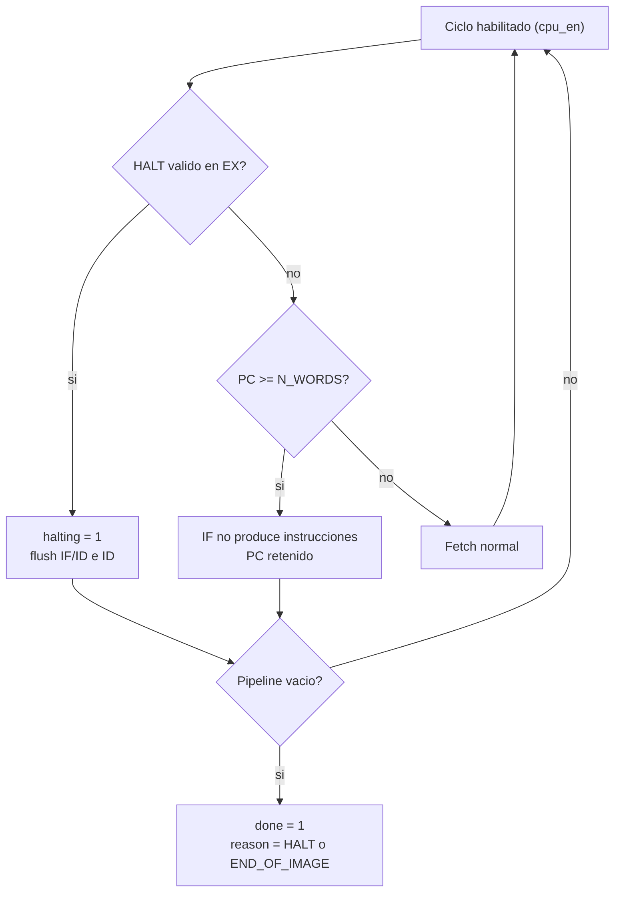
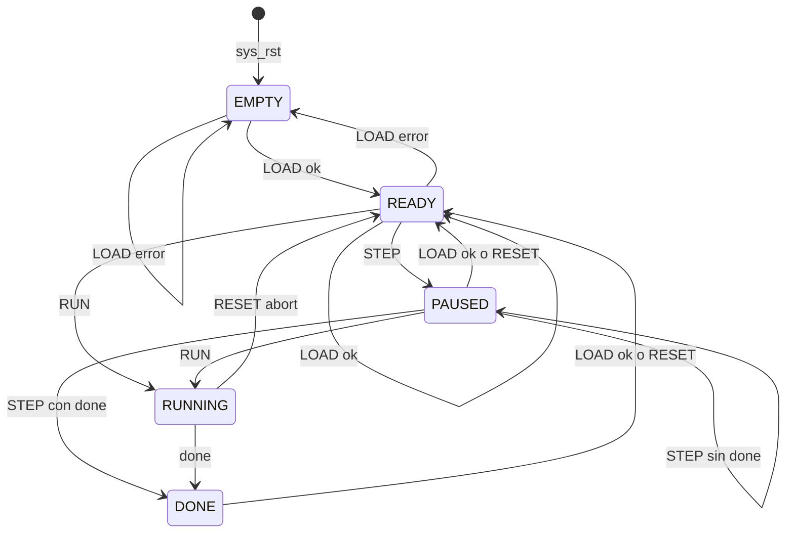
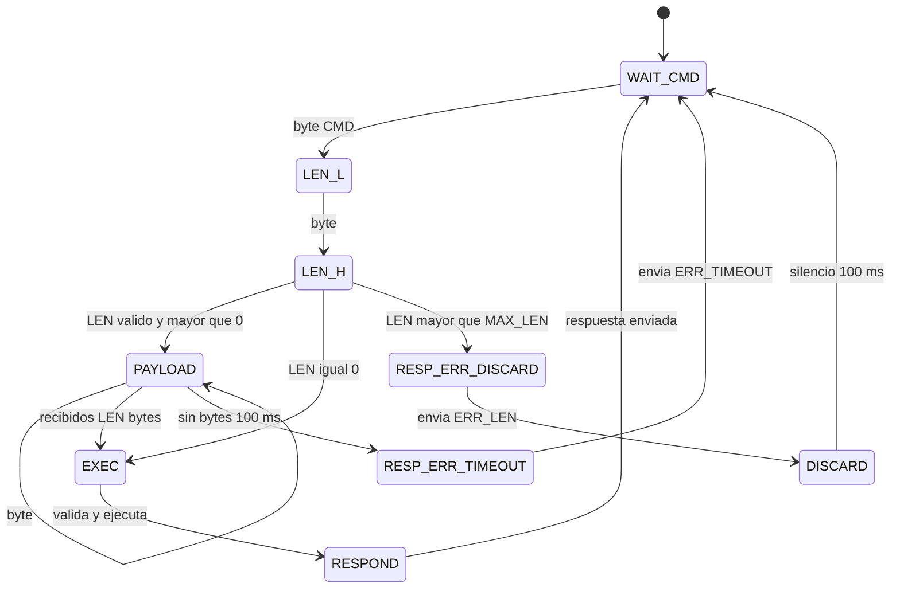
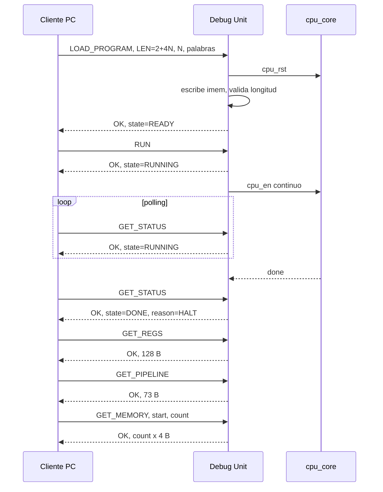
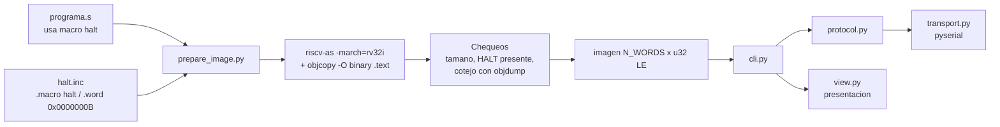

# Arquitectura del sistema — Procesador RISC-V segmentado con Debug Unit UART

> **Documento:** US-0.1 (E0) · **Estado:** borrador para revisión del Gate E0
> **Alcance:** arquitectura, contratos de interfaz, convenciones y decisiones (ADR). No contiene RTL.
> **Criterio rector:** *simple por defecto, sin sacrificar funcionalidades interesantes y baratas*
> (mismo criterio aplicado a forwarding y HALT).

---

## 0. Resumen ejecutivo

| Tema | Decisión |
| --- | --- |
| ISA | RV32I (subconjunto de la consigna) + `HALT` custom (`0x0000000B`) |
| Pipeline | 5 etapas IF/ID/EX/MEM/WB, bit `valid` en cada latch |
| Riesgos de datos | Forwarding `EX/MEM`→EX y `MEM/WB`→EX, + stall de 1 ciclo en *load-use*. Bypass WB→ID en el banco de registros |
| Riesgos de control | Branch/jump resueltos en **EX**, sin predicción, flush de 2 instrucciones (penalización: 2 ciclos) |
| Riesgos estructurales | Memorias separadas (Harvard), acceso de la Debug Unit mutuamente excluyente por estado |
| Memorias | `imem` 1024×32 (4 KiB), `dmem` 1024×32 (4 KiB), BRAM síncrona, latencia de lectura = 1 ciclo |
| Reloj | Un único `clk` (27 MHz, Tang Nano 20K), sin PLL inicialmente. *Step* y *run* con **clock-enable** `cpu_en` |
| Fin de ejecución | `done = fetch_stop && pipeline_vacío`, con razón `HALT` o `END_OF_IMAGE` |
| UART | 115200 8-N-1, request/response binario `[CMD][LEN16][PAYLOAD]` → `[STATUS][LEN16][PAYLOAD]` |
| PC | CLI en Python + GNU `as` (macro `halt`) |
| Extras baratos incluidos | Contadores `cycles`/`retired`, flags sticky de instrucción ilegal y acceso fuera de rango, `RESET` como abort |

---

## 1. Vista general del sistema



### 1.1 Jerarquía de módulos

```text
soc_top                      # clk, rst_btn_n, uart_rx_pin, uart_tx_pin, led[5:0]
├── reset_sync               # sincroniza el reset externo (power-on + botón)
├── uart_rx                  # bytes <- pin
├── uart_tx                  # bytes -> pin
├── debug_unit               # parser + FSM de sistema + secuenciador de respuestas
├── program_memory           # 1024x32, escritura DU / lectura CPU
├── data_memory              # 4 bancos de byte 1024x8, puerto A CPU, puerto B debug
└── cpu_core
    ├── pc_control           # PC, next_pc, fetch_stop
    ├── control_unit         # decode de opcode/funct3/funct7 (+ ilegal, HALT)
    ├── data_access_checker  # rango y alineacion de loads/stores en MEM
    ├── immediate_generator
    ├── register_file        # 32x32, 2R+1W, bypass WB->ID, puerto debug
    ├── forwarding_unit
    ├── hazard_unit          # stall load-use y flush
    ├── alu
    ├── halt_controller      # halting, done, done_reason
    ├── if_id_register       # latch IF/ID (valid, pc)
    ├── id_ex_register       # latch ID/EX
    ├── ex_mem_register      # latch EX/MEM
    ├── mem_wb_register      # latch MEM/WB
    └── perf_counters        # cycles, retired
```

Los nombres siguen la tabla del roadmap (§2); `halt_controller`, `hazard_unit` y `pc_control` pueden fusionarse en un solo módulo si las interfaces siguen siendo explícitas. `pipeline_registers` se materializa en cuatro módulos, uno por latch. Hasta US-3.3 el PC es una instancia de `register` dentro de `cpu_core`.

### 1.2 Parámetros globales

| Parámetro | Valor | Nota |
| --- | --- | --- |
| `CLK_HZ` | 27 000 000 | Cristal de la Tang Nano 20K |
| `BAUD` | 115200 | `BAUD_DIV = round(27e6/115200) = 234` → error ≈ +0,16 % |
| `IMEM_DEPTH` | 1024 palabras | `N_WORDS ∈ [1, 1024]` |
| `DMEM_DEPTH` | 1024 palabras | 4 KiB, espacio de direcciones `0x0000_0000–0x0000_0FFF` |
| `RX_TIMEOUT` | 100 ms (2 700 000 ciclos) | Entre bytes de un mismo mensaje |
| `MAX_LEN` | 4098 bytes | `LOAD_PROGRAM` con 1024 palabras: 2 + 4·1024 |

### 1.3 Dominio de reloj y reset

- **Un solo dominio de reloj** (`clk`). Todo el diseño es síncrono por flanco de subida; las entradas asíncronas (`uart_rx_pin`, botón) pasan por sincronizador de 2 FF.
- **Dos niveles de reset:**
  - `sys_rst`: power-on/botón. Reinicia *todo* (DU, UART, CPU, `n_words`, `prog_valid`). **No** garantiza limpieza de `imem`/`dmem`.
  - `cpu_rst`: reset **síncrono** generado por la Debug Unit (comando `RESET` o fin de `LOAD_PROGRAM`). Reinicia solo el estado del CPU (§7.1). Tiene **prioridad sobre** `cpu_en`.

---

## 2. Datapath del pipeline



### 2.1 Responsabilidad de cada etapa

| Etapa | Qué hace | Detalles de diseño |
| --- | --- | --- |
| **IF** | Presenta `PC` a `imem`; calcula `PC+4`; elige `next_pc`. | Dirección de `imem` = registro `PC` (`pc[11:2]`). La salida registrada de la BRAM **es** `IF/ID.instr`. `IF/ID.pc` = copia del PC usado. |
| **ID** | Decodifica, lee `rs1`/`rs2`, genera inmediato, calcula `uses_rs1/uses_rs2`. | Lectura **combinacional** del banco de registros con bypass WB→ID. Detecta *load-use*. |
| **EX** | Forwarding, ALU, comparador `==`, `pc+imm`, resolución de branch/jump, confirmación de `HALT`/ilegal. | Única etapa que redirige el PC. |
| **MEM** | Accede a `dmem` con `EX/MEM.result` como dirección. | Escritura efectiva al final del ciclo MEM; lectura sale registrada hacia WB. |
| **WB** | Selecciona byte/halfword, extiende signo/cero, elige `result`/`load`, escribe `rd`. | Una sola escritura por instrucción, solo si `valid && reg_write && rd≠0`. |

### 2.2 Contrato temporal (qué flanco consume cada dato)

Todo avanza en el **flanco de subida de `clk`** condicionado por `cpu_en`. Entre latches, la lógica es combinacional.

| Dato | Se produce | Se consume | Latencia |
| --- | --- | --- | --- |
| `instr` | `imem` registra en el flanco que cierra el ciclo con `PC=P` | ciclo siguiente (ID), como `IF/ID.instr` | 1 ciclo |
| `rs1v/rs2v` | lectura combinacional en ID | capturados en `ID/EX` | 0 (comb.) |
| `result` ALU | combinacional en EX | capturado en `EX/MEM` | 0 (comb.) |
| `mem_raw` (load) | `dmem` registra en el flanco que cierra el ciclo MEM | ciclo WB (comb.: lane+extensión+forward) | 1 ciclo |
| Store | `dmem` escribe en el flanco que cierra el ciclo MEM | un `lw` posterior (en MEM al ciclo siguiente) ve el dato nuevo | — |
| Escritura de registro | flanco que cierra el ciclo WB | lectura en ID del mismo ciclo ve el dato (bypass); desde el ciclo siguiente, vía banco | — |

> **Implicación:** la BRAM síncrona **no agrega etapas ni stalls** extra: su registro de salida cumple el rol del latch. Para que `IF/ID` pueda congelarse en un stall, la lectura de `imem` usa *clock-enable* (`imem_ce = cpu_en && !stall`), no un reloj distinto.

---

## 3. Latches de pipeline y validez

Cada latch tiene `valid`. Una **burbuja** es un latch con `valid=0`; **ninguna** burbuja produce efectos (escritura de registro, store, redirect, `halting`, flags sticky, contador `retired`). Tras reset todos los `valid` son 0 («etapa vacía»). La distinción «burbuja» vs «vacía» no se almacena: ambas son `valid=0` (suficiente para el requisito de que el pipeline esté vacío al terminar).

### 3.1 Word de control (`ctrl`, 16 bits): formato de `GET_PIPELINE`

En el RTL los controles viajan como señales con nombre en cada latch (por ejemplo `id_ex_reg_write`). `ctrl` y `ctrl8` solo definen cómo se empaquetan en la respuesta de `GET_PIPELINE`; el empaquetado se arma en E5, al construir `dbg_pipe`.

| Bits | Campo | Significado |
| --- | --- | --- |
| `[3:0]` | `alu_op` | `{alt, funct3}` (ver §3.3) |
| `[4]` | `src_b` | 0 = `rs2`, 1 = `imm` |
| `[5]` | `reg_write` | escribe `rd` |
| `[6]` | `mem_read` | load |
| `[7]` | `mem_write` | store |
| `[8]` | `branch` | `beq`/`bne` |
| `[9]` | `jal` | |
| `[10]` | `jalr` | |
| `[11]` | `halt` | palabra == `0x0000000B` |
| `[12]` | `illegal` | instrucción no soportada (neutralizada) |
| `[15:13]` | `funct3` | tamaño/signo de load/store; `funct3[0]` distingue `beq`(0)/`bne`(1) |

`uses_rs1` / `uses_rs2` **no viajan**: se calculan en ID solo para detectar *load-use* (evita stalls espurios cuando un campo no es fuente).

`EX/MEM.ctrl` y `MEM/WB.ctrl` (8 bits): `[0]` reg_write, `[1]` mem_read, `[2]` mem_write, `[5:3]` funct3.

En `EX/MEM`, `[7:6]` = 0. En `MEM/WB`, `[6]` = `access_out_of_range` (el acceso a datos cayó fuera de la memoria; un load así devuelve 0) y `[7]` = 0.

### 3.2 Contenido de cada latch (también es el formato de `GET_PIPELINE`)

Todos los campos de 32 bits en little-endian. Cada latch también transporta `pc` e `instr` **solo para depuración/visualización** (costo: 4×64 FF, aceptable).

| Latch | Offset | Tamaño | Campo |
| --- | --- | --- | --- |
| **IF/ID** (9 B) | +0 | 1 | `valid` (bit 0) |
| | +1 | 4 | `pc` |
| | +5 | 4 | `instr` |
| **ID/EX** (26 B) | +0 | 1 | `valid` |
| | +1 | 4 | `pc` |
| | +5 | 4 | `instr` |
| | +9 | 4 | `rs1_val` |
| | +13 | 4 | `rs2_val` |
| | +17 | 4 | `imm` |
| | +21 | 1 | `rs1` (índice) |
| | +22 | 1 | `rs2` (índice) |
| | +23 | 1 | `rd` (índice) |
| | +24 | 2 | `ctrl` (§3.1) |
| **EX/MEM** (19 B) | +0 | 1 | `valid` |
| | +1 | 4 | `pc` |
| | +5 | 4 | `instr` |
| | +9 | 4 | `result` (ALU, o `PC+4` en jal/jalr) |
| | +13 | 4 | `store_data` (rs2 ya con forwarding) |
| | +17 | 1 | `rd` |
| | +18 | 1 | `ctrl8` |
| **MEM/WB** (19 B) | +0 | 1 | `valid` |
| | +1 | 4 | `pc` |
| | +5 | 4 | `instr` |
| | +9 | 4 | `result` (ALU/link; en loads = dirección efectiva) |
| | +13 | 4 | `mem_raw` (palabra leída; solo significativa si `mem_read`) |
| | +17 | 1 | `rd` |
| | +18 | 1 | `ctrl8` (bit 6 = `access_out_of_range`) |

Offsets absolutos en la respuesta (73 B): IF/ID `0`, ID/EX `9`, EX/MEM `35`, MEM/WB `54`. El CPU expone un vector plano `dbg_pipe[583:0]` y la Debug Unit lo serializa byte a byte (la CPU está pausada, no hay riesgo de inconsistencia).

### 3.3 Decodificación

Opcodes: R `0110011` · I-ALU `0010011` · LOAD `0000011` · STORE `0100011` · BRANCH `1100011` · JAL `1101111` · JALR `1100111` · LUI `0110111` · **HALT `0001011` (custom-0)**.

**Codificación de `alu_op`** (sin tabla de traducción; deriva directo de la ISA):

| `alu_op` | Op | | `alu_op` | Op |
| --- | --- | --- | --- | --- |
| `0000` | ADD | | `0111` | AND |
| `0001` | SLL | | `1000` | SUB (`alt=1, funct3=000`) |
| `0010` | SLT | | `1101` | SRA (`alt=1, funct3=101`) |
| `0011` | SLTU | | `1111` | PASS_B (para `lui`) |
| `0100` | XOR | | | |
| `0101` | SRL | | | |
| `0110` | OR | | | |

`alt = funct7[5]`, **pero** en OP-IMM solo se usa si `funct3 == 101` (srai). Un `addi` con inmediato negativo tiene el bit 30 en 1 y **no** es `sub`.

**Tabla de control por clase:**

| Clase | `alu_op` | `src_b` | `reg_write` | `mem_r` | `mem_w` | `branch` | `jal` | `jalr` | `uses_rs1` | `uses_rs2` |
| --- | --- | --- | --- | --- | --- | --- | --- | --- | --- | --- |
| R | `{funct7[5],funct3}` | rs2 | 1 | 0 | 0 | 0 | 0 | 0 | 1 | 1 |
| I-ALU | `{alt,funct3}` | imm | 1 | 0 | 0 | 0 | 0 | 0 | 1 | 0 |
| LOAD | ADD | imm | 1 | 1 | 0 | 0 | 0 | 0 | 1 | 0 |
| STORE | ADD | imm | 0 | 0 | 1 | 0 | 0 | 0 | 1 | 1 |
| BRANCH | — | — | 0 | 0 | 0 | 1 | 0 | 0 | 1 | 1 |
| JAL | — | — | 1 | 0 | 0 | 0 | 1 | 0 | 0 | 0 |
| JALR | ADD | imm | 1 | 0 | 0 | 0 | 0 | 1 | 1 | 0 |
| LUI | PASS_B | imm | 1 | 0 | 0 | 0 | 0 | 0 | 0 | 0 |
| HALT | — | — | 0 | 0 | 0 | 0 | 0 | 0 | 0 | 0 |

**Instrucción ilegal** = cualquier palabra fuera de la lista cerrada: opcode desconocido, `funct3/funct7` inválidos (p. ej. `funct7` ≠ `0000000`/`0100000`, `blt`, `ld`), `0x00000000`, o una palabra tipo `custom-0` distinta de `0x0000000B`. Se **neutraliza** (todos los controles de efecto en 0, `illegal=1`) y, cuando llega a EX con `valid`, activa el flag sticky `illegal_seen`. No detiene el CPU.

**Generador de inmediatos** (`i` = instrucción):

| Formato | Inmediato |
| --- | --- |
| I | `{{20{i[31]}}, i[31:20]}` |
| S | `{{20{i[31]}}, i[31:25], i[11:7]}` |
| B | `{{19{i[31]}}, i[31], i[7], i[30:25], i[11:8], 1'b0}` |
| U | `{i[31:12], 12'b0}` |
| J | `{{11{i[31]}}, i[31], i[19:12], i[20], i[30:21], 1'b0}` |

Shifts inmediatos: `shamt = imm[4:0]`; la ALU solo usa `B[4:0]` en SLL/SRL/SRA.

**Resultados especiales en EX:**
- `jal`/`jalr`: `result = PC + 4` (dirección de retorno).
- `jal`/`branch` taken: `target = pc + imm` (sumador dedicado).
- `jalr`: `target = (rs1_fwd + imm) & ~32'b1` (usa la ALU, regla de la ISA).
- `beq`/`bne`: comparador de igualdad dedicado sobre operandos con forwarding: `taken = (rs1_fwd == rs2_fwd) ^ funct3[0]`.

---

## 4. Memorias

### 4.1 Mapa y contrato

| | `program_memory` | `data_memory` |
| --- | --- | --- |
| Organización | 1024 × 32 | 4 bancos de byte 1024 × 8 (lanes 0–3) |
| Espacio (bytes) | `0x000–0xFFF`, índice = `pc[11:2]` | `0x0000_0000–0x0000_0FFF`, índice = `addr[11:2]` |
| Puertos | R (CPU) + W (DU) | A: R/W (CPU) · B: R (DU, debug) |
| Lectura | síncrona, 1 ciclo, con `ce` | síncrona, 1 ciclo, con `ce` |
| Escritura | DU solo con CPU detenida | CPU en MEM: `we[3:0]` por lane |
| Contenido tras reset/carga | **se conserva** (basura permitida; `N_WORDS` la acota) | **se conserva** |

Los espacios de código y datos son **independientes** (Harvard): el programa no puede leer ni escribir su propio código, y `.data` no se carga. Los programas deben inicializar con instrucciones (`lui`/`addi`/`sw`) lo que vayan a leer. La herramienta de PC solo transmite `.text`.

Si la herramienta no infiere el puerto B sin duplicar la BRAM, se acepta la duplicación. Estimación con Yosys (`synth_gowin`): `program_memory` usa 2 bloques BSRAM y `data_memory` 8, ≈ 10 de 46 (verificar con Gowin EDA y datasheet).

### 4.2 Acceso a datos (byte lanes)

Sin sumadores extra ni *shifters* en MEM:

| Store | Dato a `dmem` | `we[3:0]` |
| --- | --- | --- |
| `sb` | `{4{data[7:0]}}` | `1 << addr[1:0]` |
| `sh` | `{2{data[15:0]}}` | `addr[1] ? 4'b1100 : 4'b0011` |
| `sw` | `data` | `4'b1111` |

| Load (en WB) | Selección desde `mem_raw` (según `result[1:0]`) | Extensión |
| --- | --- | --- |
| `lb` / `lbu` | byte lane `[1:0]` | signo / cero |
| `lh` / `lhu` | halfword `[1]` | signo / cero |
| `lw` | palabra completa | — |

### 4.3 Casos fuera de contrato (definidos, no trap)

| Caso | Comportamiento |
| --- | --- |
| Acceso desalineado (`lh/sh` con `addr[0]=1`, `lw/sw` con `addr[1:0]≠0`) | **Fuera de contrato**: se alinea hacia abajo (ignora los bits bajos). Sin excepción, pero se levanta el flag sticky `misaligned_seen`. |
| Dirección de datos `addr[31:12] ≠ 0` | Store **suprimido**, load devuelve 0, flag sticky `dmem_oob_seen`. El rango se verifica en MEM; el bit `access_out_of_range` viaja en `MEM/WB` para poner el load en 0 en WB |
| PC con `pc[1:0] ≠ 0` (p. ej. por `jalr`) | Ignora los 2 bits bajos para indexar `imem` |
| Dirección de fetch ≥ `N_WORDS·4` | No se busca (ver §6.3) |

---

## 5. Control de riesgos

### 5.1 Datos: forwarding + stall *load-use*

**Distancias de dependencia cubiertas:**

| Productor → consumidor | Mecanismo |
| --- | --- |
| Distancia 1 (productor en `EX/MEM` cuando el consumidor está en EX) | Forward `EX/MEM` → EX |
| Distancia 2 (productor en `MEM/WB`) | Forward `MEM/WB` → EX |
| Distancia 3 (productor escribiendo en WB mientras el consumidor está en ID) | Bypass en el banco de registros |
| Load seguido de consumidor inmediato | **Stall de 1 ciclo** + forward `MEM/WB` |

**Selección (fwd_a / fwd_b, 2 bits):** `00` = valor de `ID/EX`, `01` = `EX/MEM.result`, `10` = `wb_data`.

```verilog
// Prioridad: el más reciente (EX/MEM) gana sobre MEM/WB
fwd_a = (exmem.valid && exmem.reg_write && !exmem.mem_read && exmem.rd != 0 && exmem.rd == idex.rs1) ? 2'b01 :
        (memwb.valid && memwb.reg_write                      && memwb.rd != 0 && memwb.rd == idex.rs1) ? 2'b10 :
                                                                                                       2'b00;
// fwd_b idéntico con idex.rs2
```

El forward ocurre sobre ambos operandos, de modo que **`store_data`, la comparación de branches y `jalr` también usan valores adelantados**. La guarda `!exmem.mem_read` hace explícita la regla T3.2.3 (en la práctica el stall ya impide ese caso).

**Stall load-use (detectado en ID):**

```verilog
stall = ifid.valid && idex.valid && idex.mem_read && idex.rd != 0 &&
        ((uses_rs1 && ifid_rs1 == idex.rd) || (uses_rs2 && ifid_rs2 == idex.rd));
```

**ifid.valid**: hoy el procesador puede frenarse por una instrucción que en realidad ya no existe, porque IF/ID marca “no válido” pero conserva la palabra vieja. Pasa, por ejemplo, si un lw es lo último de un programa sin HALT: la palabra que sigue es un resto de un programa anterior. Esa palabra puede coincidir con el registro del load y causar un ciclo de más, de modo que cycles dependería de basura de memoria. Con ifid.valid solo se frena por instrucciones reales.

> El fix de ifid.valid es cosmético, no un bug. Dije que los ciclos podían depender de basura en imem. Lo medí y no es cierto: sin el fix la señal stall se activa una vez de más, pero los ciclos son idénticos (caso dirigido y 6000 programas). Cuando IF/ID es inválido el frente ya está vacío y el bubble en ID/EX se inserta igual. Es inocuo y puede quedar, pero no lo cuentes como corrección funcional.

Efecto del stall (todo lo demás sigue avanzando):

| Elemento | Durante el stall |
| --- | --- |
| `PC` | congelado |
| `IF/ID` (y `imem_ce`) | congelado (`valid`, `pc`, `instr` se conservan) |
| `ID/EX` | recibe burbuja (`valid=0`, controles de efecto en 0) |
| `EX/MEM`, `MEM/WB` | siguen avanzando normalmente |

> Un `store` cuyo dato (`rs2`) viene de un `lw` inmediatamente anterior también produce stall (`uses_rs2=1`). Es una simplificación deliberada (existiría un forward MEM→MEM, pero no justifica la complejidad).

**Plan B (alternativa por tiempo):** deshabilitar los muxes de forwarding (`fwd = 00`) y extender la condición de stall a cualquier dependencia con productor en `ID/EX`, `EX/MEM` o con el productor aún sin escribir en el banco. Mismas pruebas funcionales.

### 5.2 Control: branches y jumps en EX

```verilog
redirect    = idex.valid && ((idex.branch && taken) || idex.jal || idex.jalr);
redirect_pc = idex.jalr ? ({alu_result[31:1], 1'b0}) : (idex.pc + idex.imm);
flush_front = redirect || halt_commit;     // ver §6.2
```

Con `flush_front`: `IF/ID.valid ← 0` y la instrucción que estaba en ID **no entra** a `ID/EX` (`valid ← 0`). `PC ← redirect_pc` si hubo `redirect`.

- **Penalización:** 2 ciclos por salto tomado. Branch **no** tomado: 0 ciclos (el PC secuencial ya era el correcto).
- **Exclusión mutua:** `stall` y `flush_front` nunca coinciden en el mismo ciclo (ambos dependen de qué instrucción está en EX: un load para el stall, un branch/jump/HALT para el flush).
- **Instrucciones anuladas** nunca llegan a EX con `valid=1` ⇒ no pueden escribir registros ni memoria.

### 5.3 Estructurales

| Recurso potencialmente compartido | Resolución |
| --- | --- |
| Memoria (IF vs MEM) | Memorias separadas |
| Banco de registros (WB escribe, ID lee el mismo ciclo) | Bypass WB→ID dentro del banco |
| `imem` (CPU lee, DU escribe) | La DU solo escribe durante `LOAD_PROGRAM` (CPU sin `cpu_en`) |
| `dmem` (CPU en MEM, DU lee) | DU usa el puerto B, de solo lectura, y solo consulta con CPU no corriendo |
| Latch `mem_raw` vs consultas de debug | El puerto B tiene su propio registro de salida: consultar no modifica el estado del CPU |

### 5.4 Trazas de referencia

**Forwarding `EX/MEM`:** `add x5,x1,x2` ; `sub x6,x5,x3`

| Ciclo | 1 | 2 | 3 | 4 | 5 | 6 |
| --- | --- | --- | --- | --- | --- | --- |
| `add` | IF | ID | EX | MEM | WB | |
| `sub` | | IF | ID | **EX** *(fwd EX/MEM)* | MEM | WB |

**Load-use:** `lw x5,0(x1)` ; `add x6,x5,x2`

| Ciclo | 1 | 2 | 3 | 4 | 5 | 6 | 7 |
| --- | --- | --- | --- | --- | --- | --- | --- |
| `lw` | IF | ID | EX | MEM | WB | | |
| `add` | | IF | ID *(stall detectado)* | ID *(repite)* | **EX** *(fwd MEM/WB)* | MEM | WB |
| ID/EX | | | `lw` | burbuja | `add` | | |

**Branch tomado:** `beq` ; `i1` ; `i2` ; `L: i3`

| Ciclo | 1 | 2 | 3 | 4 | 5 | 6 |
| --- | --- | --- | --- | --- | --- | --- |
| `beq` | IF | ID | **EX (redirect)** | MEM | WB | |
| `i1` | | IF | ID ✗ | | | |
| `i2` | | | IF ✗ | | | |
| `i3` | | | | IF | ID | EX |

---

## 6. Reset, carga, HALT y fin de ejecución

### 6.1 Política de estado (responde a las preguntas 1–4 de la consigna)

| Evento | PC | `x1–x31` | Pipeline | `dmem` | `imem` | `n_words` | Contadores/flags |
| --- | --- | --- | --- | --- | --- | --- | --- |
| `sys_rst` (power-on/botón) | 0 | 0 | vacío | sin garantía | sin garantía | 0 (`prog_valid=0`) | 0 |
| `RESET` (comando) | 0 | 0 | vacío | **se conserva** | **se conserva** | se conserva | 0 |
| `LOAD_PROGRAM` | 0 (se aplica `cpu_rst`) | 0 | vacío | **se conserva** | se sobrescriben las primeras `N_WORDS` | = nuevo `N_WORDS` | 0 |

| Pregunta de la consigna | Respuesta |
| --- | --- |
| ¿Hay que vaciar la memoria (datos) al reprogramar? | **No.** Los programas inicializan lo que leen. Evita un recorrido de limpieza. |
| ¿Hay que limpiar el banco de registros? | **Sí**, se resetea en cada carga/reset (ejecuciones reproducibles). Es gratis: ya hay reset síncrono. |
| ¿Hay que vaciar el pipeline? | **Sí**, todos los `valid` a 0 (evita que sobreviva una instrucción de la ejecución anterior). |
| ¿Hay que vaciar la memoria de programa? | **No.** `N_WORDS` + `fetch_stop` impiden ejecutar residuos. |

`x0` siempre vale 0 (no es un registro físico escribible: la lectura de `x0` devuelve 0 y la escritura se descarta).

### 6.2 HALT: confirmación en EX

`HALT` se reconoce por palabra completa (`instr == 32'h0000000B`). **Se confirma en EX**, no en ID, porque una instrucción en ID aún puede estar en el camino equivocado de un branch que se resuelve ese mismo ciclo; una instrucción en EX es siempre no especulativa (solo EX redirige).

```verilog
halt_commit = idex.valid && idex.halt;     // en EX
// efecto al final del ciclo:
//   halting      <= 1  (sticky hasta cpu_rst)
//   flush_front  = 1   (mata IF/ID e ID, que son más jóvenes)
// HALT sigue como instrucción valida sin efectos; atraviesa EX/MEM/WB.
```

Desde ese ciclo, IF deja de producir instrucciones válidas. Las anteriores completan (registros y stores incluidos) y `HALT` atraviesa el pipeline sin efectos.

### 6.3 Fin de imagen y `done`

```verilog
fetch_ok      = (pc[31:2] < n_words);                  // PC dentro de la imagen
fetch_stop    = halting || !fetch_ok;
pipeline_empty= !ifid.valid && !idex.valid && !exmem.valid && !memwb.valid;
done          = fetch_stop && pipeline_empty;
done_reason   = halting ? HALT : END_OF_IMAGE;
```

- **Cuando `fetch_stop`:** `IF/ID.valid ← 0` en cada ciclo y el `PC` **se retiene** (en fin de imagen queda en `4·N_WORDS`, útil para depurar).
- **`END_OF_IMAGE` no es sticky:** si un branch especulativo envía el PC fuera de la imagen pero luego un branch en EX lo corrige, `fetch_ok` vuelve a 1. Solo es terminal cuando el pipeline quedó vacío (nadie puede redirigir).
- **Un salto cuyo destino cae fuera de la imagen** termina igual por `END_OF_IMAGE`.
- `done` solo se evalúa cuando la DU está en `RUNNING`/`PAUSED`; con `n_words=0` (`EMPTY`) sería trivialmente verdadero y se ignora.
- Al activarse `done`, no quedan escrituras pendientes: `MEM/WB.valid=0` implica que el último WB ya ocurrió; `EX/MEM.valid=0` implica que el último store ya se escribió.



**Respuesta a la pregunta 5 de la consigna** (*¿qué pasa si no hay HALT?*): el CPU llega a `N_WORDS`, detiene el fetch, drena el pipeline y reporta `done` con razón `END_OF_IMAGE`. Si el programa tiene un lazo infinito sin `HALT`, nunca termina: el usuario lo aborta con `RESET`.

---

## 7. Control de ejecución y modo paso a paso

### 7.1 Clock-enable único

```text
cpu_en = (state == RUNNING) | step_pulse        // step_pulse = 1 ciclo de clk
```

- Todos los FF del CPU (PC, latches, banco de registros, contadores) y las BRAM (`ce`, `we`) se condicionan con `cpu_en`. El **clock físico nunca se detiene ni se deriva**; `cpu_en` solo habilita el avance.
- `cpu_rst` tiene prioridad sobre `cpu_en`: `if (cpu_rst) ... else if (cpu_en) ...`.
- Stall/flush son lógica *interna* de un ciclo habilitado; `cpu_en` es ortogonal a ellos (T4.4.3). **Un `STEP` = un ciclo de clock del pipeline**, haya o no stall.
- Con `done=1` el CPU es idempotente (PC retenido, pipeline vacío, contadores gateados con `!done`), por lo que no hace falta que `done` participe en `cpu_en` (se evita un camino `done → CE` de alto fanout).
- UART y DU **no** dependen de `cpu_en`: siguen operativos con el CPU pausado.

### 7.2 Estados del sistema (FSM de la Debug Unit)

| Código | Estado | Significado |
| --- | --- | --- |
| 0 | `EMPTY` | Sin programa válido (power-on o carga fallida) |
| 1 | `READY` | Programa válido, CPU en estado de reset, sin ejecutar |
| 2 | `RUNNING` | Ejecución continua en curso (**busy**) |
| 3 | `PAUSED` | Se ejecutó ≥ 1 paso, no terminó |
| 4 | `DONE` | Terminó (`done_reason` = `HALT` o `END_OF_IMAGE`) |
| 5 | `LOADING` | Interno, durante `LOAD_PROGRAM` (no visible por `GET_STATUS`: la carga es bloqueante) |



### 7.3 Matriz comando × estado

| Comando | `EMPTY` | `READY` | `RUNNING` | `PAUSED` | `DONE` |
| --- | --- | --- | --- | --- | --- |
| `LOAD_PROGRAM` | OK → `READY` / error → `EMPTY` | idem | `ERR_BUSY` | idem | idem |
| `RESET` | OK → `EMPTY`* | OK → `READY` | OK (**abort**) → `READY` | OK → `READY` | OK → `READY` |
| `RUN` | `ERR_NO_PROGRAM` | OK → `RUNNING` | `ERR_BUSY` | OK → `RUNNING` | `ERR_STATE` |
| `STEP` | `ERR_NO_PROGRAM` | OK (1 ciclo) | `ERR_BUSY` | OK (1 ciclo) | `ERR_STATE` |
| `GET_STATUS` | OK | OK | **OK** | OK | OK |
| `GET_REGS` / `GET_PIPELINE` / `GET_MEMORY` | OK | OK | `ERR_BUSY` | OK | OK |

\* `RESET` resulta en `READY` si `prog_valid=1`, o `EMPTY` si no.

**`RUN` es no bloqueante:** responde `OK` de inmediato (con estado `RUNNING`) y el cliente consulta `GET_STATUS` periódicamente hasta ver `DONE`. Esto mantiene el protocolo estrictamente request/response, sin mensajes no solicitados, y permite abortar con `RESET`.

**`STEP`:** la DU emite `step_pulse` (1 ciclo), espera 1 ciclo, muestrea `done` y recién entonces responde (con el estado resultante). Las consultas posteriores devuelven la instantánea post-ciclo.

**Consultas de solo lectura:** `GET_*` nunca activan `cpu_en`, no escriben memoria ni registros, y no alteran ningún latch (la lectura de `dmem` usa el puerto B).

---

## 8. UART y Debug Unit

### 8.1 Capa física

| Parámetro | Valor |
| --- | --- |
| Formato | 115200 baudios, 8-N-1 |
| `uart_rx` | Sincronizador 2 FF; detecta flanco de start, muestrea en el centro del bit (`BAUD_DIV/2`), verifica stop. Salidas: `rx_data[7:0]`, `rx_valid` (pulso 1 ciclo), `rx_ferr` (pulso) |
| `uart_tx` | Registro de desplazamiento; entradas `tx_data`, `tx_start` (válido solo con `!tx_busy`) |
| Buffers | **Ninguno.** Un byte tarda 86,8 µs ≈ 2343 ciclos y la DU consume cada byte en ≤ 1 ciclo; no hay riesgo de *overrun* |
| Framing error | Byte descartado, mensaje en curso abortado con `ERR_FRAMING` |

### 8.2 Formato de mensajes

```text
Request  (PC → FPGA):  [CMD:1][LEN:2 LE][PAYLOAD:LEN]
Response (FPGA → PC):  [STATUS:1][LEN:2 LE][PAYLOAD:LEN]
```

Enteros multibyte en **little-endian**. Sin checksum ni versionado (decisión del roadmap). El cliente envía un request y espera la respuesta antes de enviar el siguiente.

**Comandos**

| Código | Comando | Payload del request | Payload de la respuesta (si `OK`) |
| --- | --- | --- | --- |
| `0x01` | `LOAD_PROGRAM` | `N_WORDS:u16` + `N_WORDS × u32` | `state:u8` |
| `0x02` | `RESET` | — | `state:u8` |
| `0x03` | `RUN` | — | `state:u8` |
| `0x04` | `STEP` | — | `state:u8` |
| `0x05` | `GET_STATUS` | — | 17 B (abajo) |
| `0x06` | `GET_REGS` | — | 128 B: `x0..x31`, cada uno `u32` |
| `0x07` | `GET_PIPELINE` | — | 73 B (§3.2) |
| `0x08` | `GET_MEMORY` | `start_word:u16`, `count:u16` | `count × u32` desde `dmem[start_word]` |

**Códigos de `STATUS`**

| Código | Nombre | Cuándo |
| --- | --- | --- |
| `0x00` | `OK` | Comando ejecutado |
| `0x01` | `ERR_CMD` | Comando desconocido |
| `0x02` | `ERR_LEN` | `LEN` incompatible con el comando (o `> MAX_LEN`) |
| `0x03` | `ERR_ARG` | Argumento fuera de rango (`N_WORDS` ∉ [1,1024], `start+count > 1024`, `count = 0`) |
| `0x04` | `ERR_STATE` | Comando no válido en el estado actual (p. ej. `RUN` en `DONE`) |
| `0x05` | `ERR_BUSY` | CPU en `RUNNING` |
| `0x06` | `ERR_NO_PROGRAM` | `RUN`/`STEP` sin programa válido |
| `0x07` | `ERR_TIMEOUT` | Mensaje incompleto (p. ej. carga truncada) |
| `0x08` | `ERR_FRAMING` | Error de framing UART |
| `0x09` | `ERR_INTERNAL` | Estado inconsistente / no esperado |

En una respuesta de error `LEN = 0`.

**Payload de `GET_STATUS` (17 B)**

| Offset | Tamaño | Campo |
| --- | --- | --- |
| 0 | 1 | `state` (§7.2) |
| 1 | 1 | `done_reason`: `0` ninguna, `1` HALT, `2` END_OF_IMAGE |
| 2 | 1 | `flags`: bit0 `prog_valid`, bit1 `halting`, bit2 `illegal_seen`, bit3 `dmem_oob_seen`, bit4 `misaligned_seen` |
| 3 | 2 | `n_words` |
| 5 | 4 | `pc` |
| 9 | 4 | `cycles` (ciclos habilitados desde el último reset) |
| 13 | 4 | `retired` (instrucciones que completaron WB) |

CPI ≈ `cycles / retired`.

### 8.3 Parser de la Debug Unit



Reglas:

1. **La DU siempre consume `LEN` bytes** (si `LEN ≤ MAX_LEN`) antes de validar y responder; así un comando inválido no desincroniza el flujo.
2. Solo `LEN > MAX_LEN` obliga a descartar: se responde `ERR_LEN` y se ignoran bytes hasta 100 ms de silencio.
3. Se **valida antes de modificar estado**: comando, longitud, argumentos y estado. Un comando inválido no toca CPU, memorias ni registros.
4. **Cliente tras cualquier error:** esperar ≥ 150 ms y vaciar el buffer de recepción antes del siguiente comando.

### 8.4 `LOAD_PROGRAM` (mensaje único)

1. Al recibir `CMD=0x01` en estado permitido: `prog_valid ← 0`, `n_words ← 0`, `cpu_rst`, estado `LOADING`.
2. Se leen los 2 primeros bytes de payload (`N_WORDS`). Se valida `1 ≤ N_WORDS ≤ 1024` **y** `LEN == 2 + 4·N_WORDS`. Si falla: se consumen los bytes restantes sin escribir y se responde `ERR_ARG`/`ERR_LEN`.
3. Si es válido, cada palabra completa (4 bytes LE) se escribe en `imem[i]` por el puerto de escritura de la DU.
4. Al recibirse el último byte: `n_words ← N_WORDS`, `prog_valid ← 1`, estado `READY`, respuesta `OK`.
5. Si el mensaje se trunca (100 ms sin bytes), `ERR_TIMEOUT` y el sistema queda en `EMPTY` (`prog_valid=0`): **nunca se acepta una carga incompleta**. `RUN` queda bloqueado.



---

## 9. Lado PC: toolchain y CLI



**Decisiones**

- **Ensamblador existente** (GNU binutils RISC-V o equivalente). Sin ensamblador propio.
- **`HALT`:** el script antepone un `.macro halt` que emite `.word 0x0000000B`, así el programador escribe `halt` en su fuente. El script **no agrega HALT automáticamente**: avisa si no lo encuentra (necesario para poder probar el caso `END_OF_IMAGE`; `--no-halt-check` lo silencia).
- **Cotejo (T6.1.4):** el script desensambla la imagen generada con `objdump` y verifica que la palabra `0x0000000B` aparezca exactamente donde se escribió `halt`.
- **Capas separadas:** transporte serie, protocolo (encode/decode de frames con códigos de error), presentación. El cliente **nunca informa éxito sin respuesta `OK`** y muestra timeouts/desconexiones sin ocultarlos.

**Comandos de la CLI**

| Comando | Acción |
| --- | --- |
| `load <archivo.s>` | Ensambla, valida y envía `LOAD_PROGRAM` |
| `run` | `RUN` + polling de `GET_STATUS` hasta `DONE` (con timeout configurable) y volcado final |
| `step [n]` | `n` × `STEP`, mostrando pipeline tras cada paso |
| `status`, `regs`, `pipe`, `mem <word> <n>` | Consultas |
| `reset` | `RESET` (también aborta un `run`) |

Ejemplo de salida de `pipe` (decodificación y validez a cargo del cliente, que desensambla con `instr`):

```text
cycle 12   pc=0x00000014   state=PAUSED
 IF/ID   V  pc=0x10  addi x6, x5, 1
 ID/EX   V  pc=0x0c  lw   x5, 0(x1)
 EX/MEM  -  (burbuja)
 MEM/WB  V  pc=0x04  add  x3, x1, x2   -> x3 = 0x0000000a
```

---

## 10. FPGA, reloj y timing

| Tema | Decisión |
| --- | --- |
| Placa / herramienta | Tang Nano 20K · Gowin EDA |
| Reloj | Entrada de 27 MHz → `clk` global, único. Sin PLL inicialmente |
| Constraints | `.cst` (pines: `clk`, `rst_btn_n`, UART — **confirmar con el esquemático**) y `.sdc` (`create_clock -period 37.037`) |
| Step | Habilitación síncrona (`cpu_en`); ningún *clock gating*, ningún reloj derivado |
| Camino crítico esperado (hipótesis a verificar en el reporte) | `ID/EX` → forward mux → ALU/comparador → `redirect` → mux `next_pc` → PC / `imem_addr`; también `mem_raw` → lane+extensión → forward → ALU |
| Skew | Un solo reloj global ⇒ skew bajo esperable; **no se afirma nada hasta ver el reporte** |

**Procedimiento (E7):** (1) implementar a 27 MHz y medir *slack* de setup/hold; (2) ajustar el período en el `.sdc` para encontrar la frecuencia máxima alcanzable; (3) si se decide operar a otra frecuencia, evaluar `rPLL` (y recalcular `BAUD_DIV` a partir de `CLK_HZ`); (4) documentar camino crítico, recursos y frecuencia final con capturas del reporte.

---

## 11. Mapa de interfaces

### 11.1 `soc_top` (pines)

| Señal | Dir | Ancho | Descripción |
| --- | --- | --- | --- |
| `clk` | in | 1 | 27 MHz |
| `rst_btn_n` | in | 1 | Reset externo (activo bajo), sincronizado |
| `uart_rx_pin` | in | 1 | Desde el puente USB-UART |
| `uart_tx_pin` | out | 1 | Hacia el puente USB-UART |
| `led[5:0]` | out | 6 | Opcional: `state` y flags (depuración visual) |

### 11.2 UART ↔ Debug Unit

| Señal | Productor → Consumidor | Ancho | Significado |
| --- | --- | --- | --- |
| `rx_data` | `uart_rx` → `debug_unit` | 8 | Byte recibido |
| `rx_valid` | `uart_rx` → `debug_unit` | 1 | Pulso de 1 ciclo: `rx_data` válido |
| `rx_ferr` | `uart_rx` → `debug_unit` | 1 | Pulso: error de framing |
| `tx_data` | `debug_unit` → `uart_tx` | 8 | Byte a enviar |
| `tx_start` | `debug_unit` → `uart_tx` | 1 | Pulso: iniciar envío (solo con `!tx_busy`) |
| `tx_busy` | `uart_tx` → `debug_unit` | 1 | Transmisión en curso |

### 11.3 Debug Unit ↔ CPU / memorias

| Señal | Productor → Consumidor | Ancho | Significado |
| --- | --- | --- | --- |
| `cpu_rst` | `debug_unit` → `cpu_core` | 1 | Reset síncrono del CPU (prioridad sobre `cpu_en`) |
| `cpu_en` | `debug_unit` → `cpu_core`, memorias | 1 | Habilita el avance de un ciclo |
| `n_words` | `debug_unit` → `cpu_core` | 11 | Longitud de la imagen cargada (0..1024) |
| `cpu_done` | `cpu_core` → `debug_unit` | 1 | `fetch_stop && pipeline_vacío` |
| `cpu_done_reason` | `cpu_core` → `debug_unit` | 2 | 1 = HALT, 2 = END_OF_IMAGE |
| `cpu_halting` | `cpu_core` → `debug_unit` | 1 | HALT confirmado |
| `cpu_pc` | `cpu_core` → `debug_unit` | 32 | PC actual |
| `flag_illegal`, `flag_dmem_oob`, `flag_misaligned` | `cpu_core` → `debug_unit` | 1+1 | Flags sticky |
| `cycles`, `retired` | `cpu_core` → `debug_unit` | 32+32 | Contadores |
| `dbg_reg_idx` | `debug_unit` → `cpu_core` | 5 | Registro a leer |
| `dbg_reg_data` | `cpu_core` → `debug_unit` | 32 | Valor (lectura combinacional) |
| `dbg_pipe` | `cpu_core` → `debug_unit` | 584 | Snapshot plano de los 4 latches (§3.2) |
| `imem_we`, `imem_waddr`, `imem_wdata` | `debug_unit` → `program_memory` | 1, 10, 32 | Puerto de escritura de programa |
| `dbg_dmem_addr` | `debug_unit` → `data_memory` | 10 | Índice de palabra (puerto B) |
| `dbg_dmem_rdata` | `data_memory` → `debug_unit` | 32 | Dato leído, 1 ciclo de latencia |

### 11.4 CPU ↔ memorias

| Señal | Productor → Consumidor | Ancho | Significado |
| --- | --- | --- | --- |
| `imem_addr` | `pc_control` → `program_memory` | 10 | `pc[11:2]` |
| `imem_ce` | `cpu_core` → `program_memory` | 1 | `cpu_en && !stall` |
| `imem_rdata` | `program_memory` → `cpu_core` | 32 | Se registra como `IF/ID.instr` |
| `dmem_addr` | `cpu_core` (`EX/MEM.result[11:2]`) → `data_memory` | 10 | Índice de palabra |
| `dmem_we` | `cpu_core` → `data_memory` | 4 | Habilitación por byte; 0 si `!valid`, fuera de rango o `!cpu_en` |
| `dmem_wdata` | `cpu_core` → `data_memory` | 32 | Dato con replicación por lanes |
| `dmem_rdata` | `data_memory` → `cpu_core` | 32 | Se registra como `MEM/WB.mem_raw` |

### 11.5 Señales internas del CPU

| Señal | Productor → Consumidor | Ancho | Significado |
| --- | --- | --- | --- |
| `stall` | `hazard_unit` → `pc_control`, `IF/ID`, `ID/EX` | 1 | Load-use detectado en ID |
| `redirect` | EX → `pc_control`, `hazard_unit` | 1 | Branch/jump tomado |
| `redirect_pc` | EX → `pc_control` | 32 | Destino |
| `halt_commit` | EX → `halt_controller` | 1 | `HALT` válido en EX |
| `flush_front` | `hazard_unit` → `IF/ID`, `ID/EX` | 1 | `redirect \|\| halt_commit` |
| `fwd_a`, `fwd_b` | `forwarding_unit` → EX | 2+2 | `00` ID/EX · `01` EX/MEM · `10` WB |
| `wb_data` | WB → `register_file`, EX (forward) | 32 | Resultado final de la instrucción en WB |
| `wb_we`, `wb_rd` | WB → `register_file` | 1, 5 | `memwb.valid && reg_write && rd≠0` |
| `halting` | `halt_controller` → `pc_control` | 1 | Fetch detenido por HALT |
| `fetch_ok` | `pc_control` | 1 | `pc[31:2] < n_words` |

---

## 12. Registro de decisiones (ADR resumidas)

| ID | Decisión | Alternativas | Motivo | Consecuencia |
| --- | --- | --- | --- | --- |
| ADR-01 | `imem` y `dmem` separadas | Memoria unificada con arbitraje | Elimina el riesgo estructural IF/MEM | El programa no lee su código; `.data` no se carga |
| ADR-02 | BRAM síncrona; `IF/ID.instr` = salida de BRAM; dirección = `PC` registrado | Lectura asíncrona (LUT-RAM); `next_pc` como dirección | Mapea a BSRAM, camino de `next_pc` fuera de la dirección | `imem_ce` necesario para congelar `IF/ID` |
| ADR-03 | Forwarding `EX/MEM`+`MEM/WB` y stall de 1 ciclo en load-use; plan B solo-stalls | Solo stalls desde el inicio | Criterio simple pero interesante, cubierto por el roadmap | Mux de 3 entradas en A y B |
| ADR-04 | Branch/jump en EX, sin predicción, penalización 2 | Resolver en ID; predicción | Simplicidad; fuera de alcance | Flush de IF/ID e ID |
| ADR-05 | Banco de registros combinacional con bypass WB→ID, FF con reset síncrono | BRAM para registros | Evita forward adicional y permite lectura de debug | ≈ 1000 FF y ≈ 4 900 LUT4 (≈ 24 % del chip, estimación Yosys) |
| ADR-06 | `valid` por latch | Convención NOP | Distingue burbuja de instrucción real | +4 FF |
| ADR-07 | `HALT` confirmado en EX; `done = fetch_stop && vacío` | Detectar en ID | Evita parar por una instrucción especulativa | HALT recorre el pipeline como instrucción sin efectos |
| ADR-08 | `END_OF_IMAGE` no sticky, derivado de `PC ≥ N_WORDS` | Flag sticky al leer fuera | Correcto con fetch especulativo | `PC` retenido en fin de imagen |
| ADR-09 | Ilegales neutralizadas + acceso desalineado + flag; dmem fuera de rango suprimido + flag | Excepciones/trap | Sin infraestructura de excepciones, pero observable | 3 flags en `GET_STATUS` |
| ADR-10 | Acceso desalineado fuera de contrato (alinea hacia abajo) | Soporte completo/excepción | Los tests no lo usan | Documentado y señalizado con `misaligned_seen` |
| ADR-11 | `cpu_en` único para step y run | Reloj gateado | Requisito de la consigna | Todos los FF del CPU llevan CE |
| ADR-12 | Reloj único 27 MHz sin PLL inicial | PLL desde el inicio | Menos complejidad | Frecuencia se decide en E7 |
| ADR-13 | Protocolo `[CMD][LEN16][PAYLOAD]` / `[STATUS][LEN16][PAYLOAD]`, sin checksum, con timeout de 100 ms | Checksum, framing con delimitadores | Simple, robusto con timeout | Resincronización por silencio |
| ADR-14 | `RUN` no bloqueante + polling; `RESET` como abort | `RUN` bloqueante; comando `PAUSE` | Protocolo estricto request/response; permite abortar lazos infinitos | Cliente hace polling |
| ADR-15 | Carga en un solo mensaje | Carga por chunks con ACK | Simple; 4 KiB cabe en 16 bits de `LEN` | La carga no se puede pausar |
| ADR-16 | `dmem` como 4 bancos de byte con puerto B de debug | Una memoria 32 bits con byte-enable | Inferencia portable, consultas sin alterar el CPU | Posible duplicación de BRAM |
| ADR-17 | Contadores `cycles`/`retired` | Omitirlos | Muy baratos y útiles para analizar CPI y penalizaciones | +64 FF |
| ADR-18 | GNU `as` + macro `halt`; script no agrega HALT solo | Ensamblador propio; HALT automático | Reutilizar herramientas; poder probar `END_OF_IMAGE` | Aviso si falta HALT |
| ADR-19 | Un módulo de latch por frontera (`if_id_register`, `id_ex_register`, `ex_mem_register`, `mem_wb_register`) | Un único `pipeline_registers`; el `register` genérico por campo o con todo empaquetado | Interfaz corta y propia por latch, campos con nombre, ampliable en US-3.2/3.3 | Un `always` similar repetido en cuatro módulos |
| ADR-20 | Controles como señales con nombre en el RTL; `ctrl`/`ctrl8` solo son el formato de `GET_PIPELINE` | Palabra `ctrl` empaquetada en los latches | Legibilidad: se evita decodificar posiciones de bits en cada etapa | El empaquetado se hace en E5 al armar `dbg_pipe` |
| ADR-21 | Bit `access_out_of_range` en `MEM/WB` | Recalcular el rango en WB; no zerar el load fuera de rango | El rango se verifica en MEM pero el load se resuelve en WB | Usa el bit 6 reservado de `ctrl8` de `MEM/WB` |

---

## 13. Gate E0 — verificación de criterios

| Criterio del Gate | Dónde se cumple |
| --- | --- |
| Diagrama de arquitectura y mapa de interfaces actualizados | §1, §2, §11 |
| Cada señal con productor, consumidor, ancho y significado | §11 (y §3.2 para latches) |
| Reset, carga, `run`, `step`, `halt`, estado y errores definidos | §6, §7, §8 |
| Sin decisiones críticas escondidas | §12 |

| Tarea | Cubierta en |
| --- | --- |
| T0.1.1 datapath | §2 |
| T0.1.2 conexión PC ↔ UART ↔ DU ↔ memoria/CPU | §1, §9 |
| T0.1.3 anchos, direcciones, latencia, flanco | §1.2, §2.2, §4, §11 |
| T0.1.4 reset, `valid`, stall, flush, HALT, fin de imagen, `busy/done/error` | §3, §5, §6, §7 |
| T0.1.5 protocolo UART | §8 |
| T0.1.6 decisiones | §12 |

**Trazabilidad preliminar (MUST → módulos)**

| Requisito | Módulos responsables |
| --- | --- |
| Pipeline de 5 etapas con latches | `if_id_register`, `id_ex_register`, `ex_mem_register`, `mem_wb_register`, `cpu_core` |
| ISA enumerada | `control_unit`, `immediate_generator`, `alu`, `register_file`, `data_memory` |
| Riesgos de datos/control/estructurales | `hazard_unit`, `forwarding_unit`, `pc_control`, memorias separadas |
| 32 registros, latches y memoria de datos por UART | `debug_unit`, `register_file` (puerto debug), `dbg_pipe`, `data_memory` (puerto B) |
| Programación dinámica por UART | `debug_unit`, `program_memory` (puerto de escritura) |
| HALT y vaciado | `halt_controller`, `control_unit` |
| Paso a paso sin intervenir el clock | `debug_unit` (`cpu_en`), CE en todo el CPU |
| Análisis de timing | `soc_top`, reportes de Gowin EDA |
| Interfaz de PC | `cli.py`, `protocol.py`, `transport.py`, `prepare_image.py` |

Las pruebas y evidencias de cada fila se asignarán en E1–E8 (regla de trazabilidad).

---

## 14. Inconsistencias detectadas y puntos a confirmar

1. **Forwarding vs. solo stalls.** T0.1.6 del roadmap dice «stalls sin forwarding», pero la teoría, los lineamientos y US-3.2 indican forwarding con stalls como plan B. *Este documento sigue la segunda lectura.* Conviene corregir T0.1.6.
2. **Vivado vs. Gowin EDA.** La consigna exige reportes de Vivado; la placa es una Tang Nano 20K. Confirmar con el profesor que se aceptan los reportes de Gowin.
3. **«Frecuencia óptima» vs. «sin PLL».** La consigna pide encontrar y *aplicar* una frecuencia óptima. Si esta difiere de 27 MHz hará falta un `rPLL` (no es intervención manual del clock, pero conviene confirmarlo).
4. **`ld` en la tabla de la consigna.** Aparece `ld` (funct3 `011`), que es RV64. La lista obligatoria es RV32 (`lb/lh/lw/lbu/lhu`). No se implementa `ld`; se decodifica como ilegal.
5. **HALT agregado automáticamente (T6.1.2) vs. «el programa debe incluir HALT».** Se adopta que el programador escribe `halt` y la herramienta solo avisa si falta.
6. **US-4.2: «las palabras cargadas se leen idénticas a las enviadas».** Con los comandos mínimos no hay lectura de vuelta de `imem` por UART. Se verifica en simulación; si se desea verificación en hardware, agregar un `GET_PROGRAM` (P2, requiere segundo puerto de lectura de `imem`).
7. **Tamaños de memoria y datos de placa** (cantidad de BSRAM, pines UART/botón/LED): verificar en el datasheet/esquemático antes de E7.
