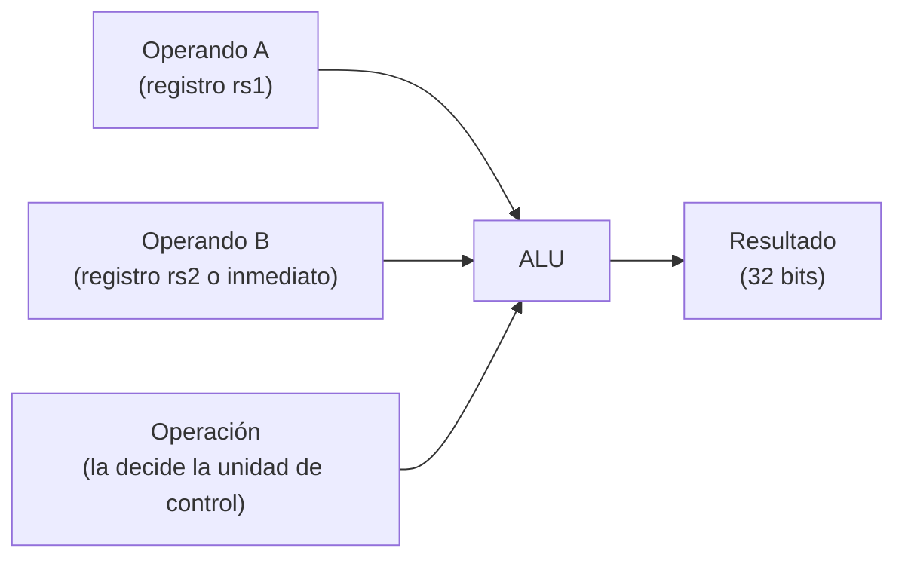

# CPU RISC-V

## ALU (Unidad Aritmético-Lógica)

### ¿Qué es y para qué sirve?

La **ALU** es el bloque del procesador que hace los cálculos. Recibe dos números de 32 bits y una orden que indica qué operación realizar (sumar, restar, comparar, desplazar, etc.), y devuelve el resultado.

Es un circuito **combinacional**: no tiene memoria ni reloj propio. El resultado aparece directamente a partir de lo que hay en sus entradas, sin esperar a ningún ciclo.

> **Analogía:** es una calculadora con un selector. Se le dan dos números, se gira el selector a la operación deseada y muestra el resultado.

### ¿Dónde está dentro del procesador?

Trabaja en la etapa **EX (Execute)** del pipeline:



La ALU **no decide qué operación hacer**: esa decisión la toma la unidad de control al decodificar la instrucción. La ALU solo obedece el código que recibe.

### Interfaz

| Señal | Dirección | Ancho | Descripción |
| --- | --- | --- | --- |
| `i_operand_a` | Entrada | 32 bits | Primer operando (normalmente el valor de `rs1`) |
| `i_operand_b` | Entrada | 32 bits | Segundo operando (valor de `rs2` o un inmediato) |
| `i_alu_op` | Entrada | 4 bits | Código de la operación a realizar |
| `o_result` | Salida | 32 bits | Resultado de la operación |

### Operaciones soportadas

| Código `i_alu_op` | Operación | Qué hace | Ejemplo |
| --- | --- | --- | --- |
| `0000` | **ADD** | Suma | `5 + 7 = 12` |
| `1000` | **SUB** | Resta | `10 − 3 = 7` |
| `0111` | **AND** | Y lógico bit a bit | `1100 AND 1010 = 1000` |
| `0110` | **OR** | O lógico bit a bit | `1100 OR 1010 = 1110` |
| `0100` | **XOR** | O exclusivo bit a bit | `1100 XOR 1010 = 0110` |
| `0001` | **SLL** | Desplaza a la izquierda, rellenando con ceros | `1 << 4 = 16` |
| `0101` | **SRL** | Desplaza a la derecha, rellenando con ceros | `0x80000000 >> 4 = 0x08000000` |
| `1101` | **SRA** | Desplaza a la derecha **conservando el signo** | `0x80000000 >>> 4 = 0xF8000000` |
| `0010` | **SLT** | Devuelve 1 si A < B **con signo**, si no 0 | `-1 < 1 → 1` |
| `0011` | **SLTU** | Devuelve 1 si A < B **sin signo**, si no 0 | `0xFFFFFFFF < 1 → 0` |
| `1111` | **PASS_B** | Devuelve B sin modificarlo (se usa en `lui`) | `B = 0x12345000 → 0x12345000` |

Cualquier otro código devuelve **0**. Así la salida nunca queda indefinida si llega un código inesperado.

### Detalles importantes

#### Desplazamientos: solo cuentan 5 bits
Para desplazar un número de 32 bits solo se necesitan cantidades de 0 a 31, que caben en 5 bits. Por eso la ALU usa únicamente los **5 bits bajos** de `i_operand_b` como cantidad de desplazamiento e ignora el resto.

#### Lógico vs. aritmético en desplazamientos a la derecha
La diferencia está en qué se coloca en los bits que quedan vacíos:

| Operación | Relleno | Útil para |
| --- | --- | --- |
| **SRL** (lógico) | Siempre ceros | Números sin signo |
| **SRA** (aritmético) | Copia del bit de signo | Números con signo (mantiene el signo negativo) |

#### Con signo vs. sin signo en comparaciones
Los mismos 32 bits pueden interpretarse de dos formas, y el resultado cambia:

| A | B | `SLT` (con signo) | `SLTU` (sin signo) |
| --- | --- | --- | --- |
| `0xFFFFFFFF` | `0x00000001` | **1** (−1 < 1) | **0** (4 294 967 295 > 1) |
| `0x80000000` | `0x7FFFFFFF` | **1** (negativo < positivo) | **0** (2 147 483 648 > 2 147 483 647) |

#### Desbordamiento (overflow)
No hay excepciones ni señales de error. Si una suma o resta excede los 32 bits, el resultado simplemente se trunca. Esto es lo que define la ISA RISC-V:

- `0xFFFFFFFF + 1 = 0x00000000`
- `0 − 1 = 0xFFFFFFFF`

### ¿Cómo se elige el código de operación?

El código de 4 bits se forma con dos campos de la propia instrucción:

```text
i_alu_op = { funct7[5] , funct3 }
```

Gracias a esto, la unidad de control casi no necesita una tabla de traducción: para las instrucciones aritméticas y lógicas copia esos bits directamente. `ADD` y `SUB`, por ejemplo, tienen el mismo `funct3` y se diferencian solo por `funct7[5]`.

Algunos casos son especiales:

| Instrucciones | Código usado | Motivo |
| --- | --- | --- |
| `lb`, `lh`, `lw`, `lbu`, `lhu`, `sb`, `sh`, `sw`, `jalr` | `ADD` | Calculan una dirección: `registro + inmediato` |
| `lui` | `PASS_B` | Solo necesita pasar el inmediato ya preparado |
| `addi`, `andi`, `ori`, `xori`, `slti`, `sltiu`, `slli`, `srli` | El de su versión con registros | Misma operación, con inmediato como operando B |
| `srai` | `SRA` | `funct7[5]` solo se considera cuando `funct3 = 101` |

> **Cuidado con `addi`:** un inmediato negativo tiene el bit 30 en 1, y eso no debe interpretarse como `SUB`. Por eso `funct7[5]` se ignora en las instrucciones con inmediato, salvo en `srai`.

### ¿Qué NO hace la ALU?

- **No decodifica instrucciones.** Eso es trabajo de la unidad de control.
- **No resuelve `beq`, `bne` ni `jal`.** Esas instrucciones usan un comparador de igualdad y un sumador `pc + inmediato` dedicados en la etapa EX.
- **No tiene estado.** No guarda valores ni depende del reloj.
- **No genera señales de error.** No hay banderas de overflow, cero o acarreo.

### Cómo se verificó

Se escribió un testbench autoverificable: cada caso define la operación, los operandos y el **resultado esperado**, y el testbench compara contra el resultado real de la ALU. Al final informa `PASS` o `FAIL`.

| Aspecto | Qué se probó |
| --- | --- |
| Aritmética | Casos normales, overflow, underflow, negativos, máximo positivo y mínimo negativo |
| Lógicas | Patrones alternados y operandos iguales |
| Desplazamientos | Cantidades 0 y 31, y que solo se usen los 5 bits bajos |
| SRA vs. SRL | Con valores negativos y positivos |
| SLT vs. SLTU | Casos donde los resultados difieren |
| PASS_B | Que devuelva exactamente B |
| Códigos no definidos | Que devuelvan 0 |

**Resultado:** 40 pruebas, 0 errores.

### Archivos del módulo

| Archivo | Contenido |
| --- | --- |
| `src/alu.v` | Implementación de la ALU |
| `src/alu_ops.vh` | Definición de los códigos de operación (compartida con la unidad de control) |
| `tests/tb_alu.v` | Testbench autoverificable |

## Banco de registros

### ¿Qué es y para qué sirve?

El banco de registros es la **memoria rápida interna del procesador**. Guarda 32 valores de 32 bits, llamados `x0` a `x31`, que las instrucciones usan como operandos y como destino de sus resultados.

Se parece a un cajón de 32 casilleros numerados. Cada instrucción puede pedir el contenido de dos casilleros y, más adelante, guardar un resultado en uno.

Por ejemplo, la instrucción `add x3, x1, x2` hace lo siguiente:

1. Lee el contenido de `x1` y de `x2`.
2. La ALU los suma.
3. El resultado se guarda en `x3`.

### ¿Dónde encaja en el pipeline?

El banco de registros participa en **dos etapas distintas** del pipeline:

| Etapa | Qué hace el banco de registros |
| --- | --- |
| **ID** (decodificación) | Entrega los valores de los dos registros fuente (`rs1` y `rs2`) |
| **WB** (escritura final) | Recibe el resultado de la instrucción y lo guarda en el registro destino (`rd`) |

Como dos instrucciones diferentes pueden estar en ID y en WB **al mismo tiempo**, el banco debe poder **leer dos valores y escribir uno en el mismo ciclo**.

```text
          ┌─────────────────────────────┐
 ID  ───► │  Lectura A  ──►  dato A     │
 ID  ───► │  Lectura B  ──►  dato B     │
 WB  ───► │  Escritura  (dirección+dato)│
          └─────────────────────────────┘
```

### Reglas de funcionamiento

**El registro `x0` es especial.**
Siempre vale cero. Cualquier intento de escribirlo se ignora. RISC-V lo usa como "constante cero" (por ejemplo, para comparar contra cero o descartar un resultado).

**Las lecturas son inmediatas.**
No esperan al reloj: en cuanto se indica qué registro se quiere leer, el dato aparece. Se pueden leer dos registros distintos a la vez, o incluso el mismo dos veces.

**La escritura ocurre en el flanco del reloj.**
El dato queda guardado al final del ciclo, y solo si se cumplen **las tres condiciones**:

- el CPU está avanzando (`i_cpu_en = 1`);
- la instrucción pide escribir (`i_write_enable = 1`);
- el destino **no** es `x0`.

Si falta alguna, no se guarda nada. Esto garantiza que una burbuja del pipeline o un `STEP` pausado nunca modifiquen el estado por accidente.

**El reset limpia todo.**
Al resetear, los 32 registros vuelven a cero. El reset tiene prioridad sobre cualquier escritura simultánea. Así cada ejecución de un programa comienza desde un estado conocido y reproducible.

El bypass: leer un dato que se está escribiendo

#### El problema

Imaginá que una instrucción está **terminando** y guardando un resultado en `x5`, mientras otra instrucción, **en ese mismo ciclo**, quiere leer `x5`.

Sin ayuda, la lectura devolvería el valor **viejo**, porque la escritura recién se concreta al final del ciclo.

#### La solución

El banco incluye un **bypass**: si detecta que se está escribiendo justo el registro que se está leyendo, entrega directamente el **dato nuevo**, sin esperar.

| Situación en el ciclo | Valor que devuelve la lectura |
| --- | --- |
| Se lee `x0` | `0` (siempre) |
| Se lee el mismo registro que se está escribiendo | El **dato nuevo** (bypass) |
| Cualquier otro caso | El valor almacenado en el registro |

El bypass **solo se activa si la escritura es efectiva** (reglas de la sección 3.3). Si el CPU está pausado, la lectura devuelve el valor guardado, porque esa escritura no se va a concretar.


### Puerto de depuración

El banco ofrece un tercer puerto de **solo lectura** para la Debug Unit, que permite consultar cualquiera de los 32 registros y enviarlos por UART a la PC.

- Devuelve el valor **realmente almacenado**, sin bypass.
- **No altera nada**: consultar el estado nunca cambia lo que está haciendo el CPU.

### Interfaz del módulo

Convención de nombres: `i_` para entradas y `o_` para salidas.

| Señal | Dir. | Ancho | Descripción |
| --- | --- | --- | --- |
| `i_clk` | entrada | 1 | Reloj del sistema |
| `i_reset` | entrada | 1 | Reset síncrono: pone todos los registros en cero |
| `i_cpu_en` | entrada | 1 | El CPU avanza en este ciclo |
| `i_read_addr_a` | entrada | 5 | Registro a leer por el puerto A (`rs1`) |
| `i_read_addr_b` | entrada | 5 | Registro a leer por el puerto B (`rs2`) |
| `o_read_data_a` | salida | 32 | Valor leído por el puerto A |
| `o_read_data_b` | salida | 32 | Valor leído por el puerto B |
| `i_write_enable` | entrada | 1 | La instrucción en WB quiere escribir |
| `i_write_addr` | entrada | 5 | Registro destino (`rd`) |
| `i_write_data` | entrada | 32 | Valor a guardar |
| `i_debug_read_addr` | entrada | 5 | Registro a consultar desde debug |
| `o_debug_read_data` | salida | 32 | Valor del registro consultado |

El módulo es parametrizable (`DATA_WIDTH`, `ADDR_WIDTH`, `REG_COUNT`), con valores por defecto de 32 bits, 5 bits de dirección y 32 registros.

### Decisiones de diseño y su justificación

| Decisión | Motivo |
| --- | --- |
| Lectura combinacional (no sincrónica) | Los operandos están disponibles dentro de la propia etapa ID, sin agregar un ciclo de latencia al pipeline |
| Bypass dentro del banco | Resuelve en un solo lugar el caso de lectura y escritura simultáneas, sin lógica adicional en el resto del CPU |
| Reset de todos los registros | Cada ejecución es reproducible, y el costo es nulo porque ya existe un reset síncrono |
| `x0` forzado a cero en la lectura | Garantiza el valor cero aunque el almacenamiento tuviera otro contenido |
| Escritura condicionada por `i_cpu_en` | Respeta el modo paso a paso sin intervenir el reloj físico |
| Puerto de debug separado, sin bypass | La depuración muestra el estado real y no interfiere con la ejecución |

### Archivos del módulo

| Archivo | Contenido |
| --- | --- |
| `src/registers.v` | Implementación del banco de registros |
| `tests/tb_registers.v` | Testbench autoverificable |