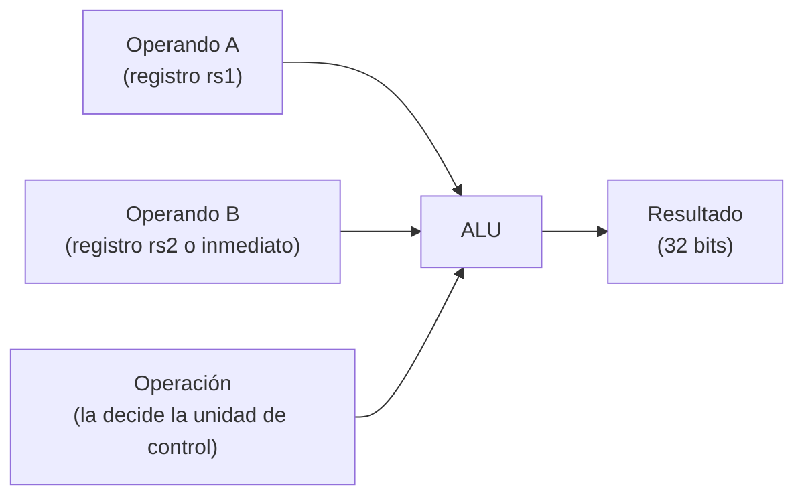
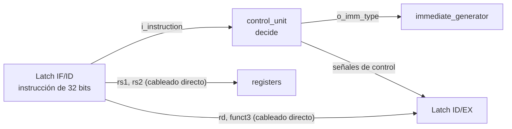
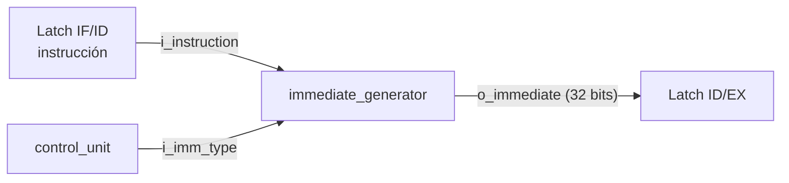
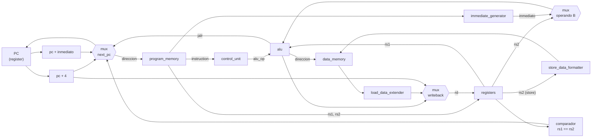
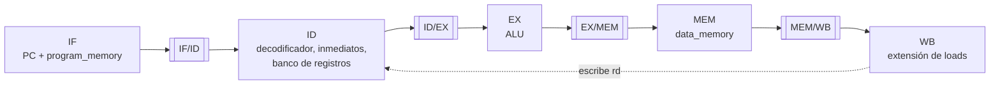

# CPU RISC-V

## Multiplexor genérico (`mux`)

Un único módulo configurable reemplaza a los multiplexores de cada punto del datapath.

| Parámetro | Descripción |
| --- | --- |
| `DATA_WIDTH` | Ancho en bits de cada entrada y de la salida |
| `INPUT_COUNT` | Cantidad de entradas (mínimo 2) |

| Puerto | Dir | Ancho | Descripción |
| --- | --- | --- | --- |
| `i_inputs` | in | `INPUT_COUNT × DATA_WIDTH` | Todas las entradas concatenadas en un bus |
| `i_select` | in | `clog2(INPUT_COUNT)` | Índice de la entrada elegida |
| `o_output` | out | `DATA_WIDTH` | Entrada seleccionada |

**Cómo se arma el bus de entradas.** La entrada 0 ocupa los bits menos significativos y se escribe **última** en la concatenación:

```verilog
// Mux de 3 entradas: select 0 -> pc_plus_4, 1 -> pc_plus_immediate, 2 -> jalr_target
.i_inputs ({jalr_target, pc_plus_immediate, pc_plus_4})
```

Si `i_select` apunta a una entrada que no existe (por ejemplo `3` en un mux de 3 entradas), la salida vale cero en lugar de quedar indefinida.

## Registro genérico (`register`)

Guarda un valor de `DATA_WIDTH` bits en cada flanco de subida del reloj.

| Puerto / parámetro | Descripción |
| --- | --- |
| `DATA_WIDTH` | Ancho del registro |
| `RESET_VALUE` | Valor que toma con el reset (por defecto, cero) |
| `i_reset` | Reset sincrónico. **Tiene prioridad** sobre `i_enable` |
| `i_enable` | Si vale 1, el registro carga `i_data` en el flanco de reloj |
| `i_data` / `o_data` | Dato de entrada y valor almacenado |

Se usa dos veces en el datapath: como **PC** (32 bits, reset en 0) y como **flag de espera de load** (1 bit).

## ALU (Unidad Aritmético-Lógica)

### ¿Qué es y para qué sirve?

La **ALU** es el bloque del procesador que hace los cálculos. Recibe dos números de 32 bits y una orden que indica qué operación realizar (sumar, restar, comparar, desplazar, etc.), y devuelve el resultado.

Es un circuito **combinacional**: no tiene memoria ni reloj propio. El resultado aparece directamente a partir de lo que hay en sus entradas, sin esperar a ningún ciclo.

> **Analogía:** es una calculadora con un selector. Se le dan dos números, se gira el selector a la operación deseada y muestra el resultado.

### ¿Dónde está dentro del procesador?

Trabaja en la etapa **EX (Execute)** del pipeline:



La ALU **no decide qué operación hacer**: esa decisión la toma la unidad de control al decodificar la instrucción. La ALU solo obedece el código que recibe.

### Interfaz

| Señal | Dirección | Ancho | Descripción |
| --- | --- | --- | --- |
| `i_operand_a` | Entrada | 32 bits | Primer operando (normalmente el valor de `rs1`) |
| `i_operand_b` | Entrada | 32 bits | Segundo operando (valor de `rs2` o un inmediato) |
| `i_alu_op` | Entrada | 4 bits | Código de la operación a realizar |
| `o_result` | Salida | 32 bits | Resultado de la operación |

### Operaciones soportadas

| Código `i_alu_op` | Operación | Qué hace | Ejemplo |
| --- | --- | --- | --- |
| `0000` | **ADD** | Suma | `5 + 7 = 12` |
| `1000` | **SUB** | Resta | `10 − 3 = 7` |
| `0111` | **AND** | Y lógico bit a bit | `1100 AND 1010 = 1000` |
| `0110` | **OR** | O lógico bit a bit | `1100 OR 1010 = 1110` |
| `0100` | **XOR** | O exclusivo bit a bit | `1100 XOR 1010 = 0110` |
| `0001` | **SLL** | Desplaza a la izquierda, rellenando con ceros | `1 << 4 = 16` |
| `0101` | **SRL** | Desplaza a la derecha, rellenando con ceros | `0x80000000 >> 4 = 0x08000000` |
| `1101` | **SRA** | Desplaza a la derecha **conservando el signo** | `0x80000000 >>> 4 = 0xF8000000` |
| `0010` | **SLT** | Devuelve 1 si A < B **con signo**, si no 0 | `-1 < 1 → 1` |
| `0011` | **SLTU** | Devuelve 1 si A < B **sin signo**, si no 0 | `0xFFFFFFFF < 1 → 0` |
| `1111` | **PASS_B** | Devuelve B sin modificarlo (se usa en `lui`) | `B = 0x12345000 → 0x12345000` |

Cualquier otro código devuelve **0**. Así la salida nunca queda indefinida si llega un código inesperado.

### Detalles importantes

#### Desplazamientos: solo cuentan 5 bits
Para desplazar un número de 32 bits solo se necesitan cantidades de 0 a 31, que caben en 5 bits. Por eso la ALU usa únicamente los **5 bits bajos** de `i_operand_b` como cantidad de desplazamiento e ignora el resto.

#### Lógico vs. aritmético en desplazamientos a la derecha
La diferencia está en qué se coloca en los bits que quedan vacíos:

| Operación | Relleno | Útil para |
| --- | --- | --- |
| **SRL** (lógico) | Siempre ceros | Números sin signo |
| **SRA** (aritmético) | Copia del bit de signo | Números con signo (mantiene el signo negativo) |

#### Con signo vs. sin signo en comparaciones
Los mismos 32 bits pueden interpretarse de dos formas, y el resultado cambia:

| A | B | `SLT` (con signo) | `SLTU` (sin signo) |
| --- | --- | --- | --- |
| `0xFFFFFFFF` | `0x00000001` | **1** (−1 < 1) | **0** (4 294 967 295 > 1) |
| `0x80000000` | `0x7FFFFFFF` | **1** (negativo < positivo) | **0** (2 147 483 648 > 2 147 483 647) |

#### Desbordamiento (overflow)
No hay excepciones ni señales de error. Si una suma o resta excede los 32 bits, el resultado simplemente se trunca. Esto es lo que define la ISA RISC-V:

- `0xFFFFFFFF + 1 = 0x00000000`
- `0 − 1 = 0xFFFFFFFF`

### ¿Cómo se elige el código de operación?

El código de 4 bits se forma con dos campos de la propia instrucción:

```text
i_alu_op = { funct7[5] , funct3 }
```

Gracias a esto, la unidad de control casi no necesita una tabla de traducción: para las instrucciones aritméticas y lógicas copia esos bits directamente. `ADD` y `SUB`, por ejemplo, tienen el mismo `funct3` y se diferencian solo por `funct7[5]`.

Algunos casos son especiales:

| Instrucciones | Código usado | Motivo |
| --- | --- | --- |
| `lb`, `lh`, `lw`, `lbu`, `lhu`, `sb`, `sh`, `sw`, `jalr` | `ADD` | Calculan una dirección: `registro + inmediato` |
| `lui` | `PASS_B` | Solo necesita pasar el inmediato ya preparado |
| `addi`, `andi`, `ori`, `xori`, `slti`, `sltiu`, `slli`, `srli` | El de su versión con registros | Misma operación, con inmediato como operando B |
| `srai` | `SRA` | `funct7[5]` solo se considera cuando `funct3 = 101` |

> **Cuidado con `addi`:** un inmediato negativo tiene el bit 30 en 1, y eso no debe interpretarse como `SUB`. Por eso `funct7[5]` se ignora en las instrucciones con inmediato, salvo en `srai`.

### ¿Qué NO hace la ALU?

- **No decodifica instrucciones.** Eso es trabajo de la unidad de control.
- **No resuelve `beq`, `bne` ni `jal`.** Esas instrucciones usan un comparador de igualdad y un sumador `pc + inmediato` dedicados en la etapa EX.
- **No tiene estado.** No guarda valores ni depende del reloj.
- **No genera señales de error.** No hay banderas de overflow, cero o acarreo.

### Archivos del módulo

| Archivo | Contenido |
| --- | --- |
| `src/alu.v` | Implementación de la ALU |
| `src/alu_ops.vh` | Definición de los códigos de operación (compartida con la unidad de control) |
| `tests/tb_alu.v` | Testbench autoverificable |

## Banco de registros

### ¿Qué es y para qué sirve?

El banco de registros es la **memoria rápida interna del procesador**. Guarda 32 valores de 32 bits, llamados `x0` a `x31`, que las instrucciones usan como operandos y como destino de sus resultados.

Se parece a un cajón de 32 casilleros numerados. Cada instrucción puede pedir el contenido de dos casilleros y, más adelante, guardar un resultado en uno.

Por ejemplo, la instrucción `add x3, x1, x2` hace lo siguiente:

1. Lee el contenido de `x1` y de `x2`.
2. La ALU los suma.
3. El resultado se guarda en `x3`.

### ¿Dónde encaja en el pipeline?

El banco de registros participa en **dos etapas distintas** del pipeline:

| Etapa | Qué hace el banco de registros |
| --- | --- |
| **ID** (decodificación) | Entrega los valores de los dos registros fuente (`rs1` y `rs2`) |
| **WB** (escritura final) | Recibe el resultado de la instrucción y lo guarda en el registro destino (`rd`) |

Como dos instrucciones diferentes pueden estar en ID y en WB **al mismo tiempo**, el banco debe poder **leer dos valores y escribir uno en el mismo ciclo**.

```text
          ┌─────────────────────────────┐
 ID  ───► │  Lectura A  ──►  dato A     │
 ID  ───► │  Lectura B  ──►  dato B     │
 WB  ───► │  Escritura  (dirección+dato)│
          └─────────────────────────────┘
```

### Reglas de funcionamiento

**El registro `x0` es especial.**
Siempre vale cero. Cualquier intento de escribirlo se ignora. RISC-V lo usa como "constante cero" (por ejemplo, para comparar contra cero o descartar un resultado).

**Las lecturas son inmediatas.**
No esperan al reloj: en cuanto se indica qué registro se quiere leer, el dato aparece. Se pueden leer dos registros distintos a la vez, o incluso el mismo dos veces.

**La escritura ocurre en el flanco del reloj.**
El dato queda guardado al final del ciclo, y solo si se cumplen **las tres condiciones**:

- el CPU está avanzando (`i_cpu_en = 1`);
- la instrucción pide escribir (`i_write_enable = 1`);
- el destino **no** es `x0`.

Si falta alguna, no se guarda nada. Esto garantiza que una burbuja del pipeline o un `STEP` pausado nunca modifiquen el estado por accidente.

**El reset limpia todo.**
Al resetear, los 32 registros vuelven a cero. El reset tiene prioridad sobre cualquier escritura simultánea. Así cada ejecución de un programa comienza desde un estado conocido y reproducible.

### El bypass: leer un dato que se está escribiendo

#### El problema

Imaginá que una instrucción está **terminando** y guardando un resultado en `x5`, mientras otra instrucción, **en ese mismo ciclo**, quiere leer `x5`.

Sin ayuda, la lectura devolvería el valor **viejo**, porque la escritura recién se concreta al final del ciclo.

#### La solución

El banco incluye un **bypass**: si detecta que se está escribiendo justo el registro que se está leyendo, entrega directamente el **dato nuevo**, sin esperar.

| Situación en el ciclo | Valor que devuelve la lectura |
| --- | --- |
| Se lee `x0` | `0` (siempre) |
| Se lee el mismo registro que se está escribiendo | El **dato nuevo** (bypass) |
| Cualquier otro caso | El valor almacenado en el registro |

El bypass **solo se activa si la escritura es efectiva** (las tres condiciones de escritura descritas arriba). Si el CPU está pausado, la lectura devuelve el valor guardado, porque esa escritura no se va a concretar.

### Puerto de depuración

El banco ofrece un tercer puerto de **solo lectura** para la Debug Unit, que permite consultar cualquiera de los 32 registros y enviarlos por UART a la PC.

- Devuelve el valor **realmente almacenado**, sin bypass.
- **No altera nada**: consultar el estado nunca cambia lo que está haciendo el CPU.
- Como no pasa por el bypass, con el CPU pausado a mitad de una ejecución **todavía no muestra** el resultado de la instrucción que está en WB: ese valor se guarda recién cuando el CPU avanza el siguiente ciclo. Con la ejecución finalizada el pipeline está vacío, así que los valores son los definitivos.

### Interfaz del módulo

Convención de nombres: `i_` para entradas y `o_` para salidas.

| Señal | Dir. | Ancho | Descripción |
| --- | --- | --- | --- |
| `i_clk` | entrada | 1 | Reloj del sistema |
| `i_reset` | entrada | 1 | Reset síncrono: pone todos los registros en cero |
| `i_cpu_en` | entrada | 1 | El CPU avanza en este ciclo |
| `i_read_addr_a` | entrada | 5 | Registro a leer por el puerto A (`rs1`) |
| `i_read_addr_b` | entrada | 5 | Registro a leer por el puerto B (`rs2`) |
| `o_read_data_a` | salida | 32 | Valor leído por el puerto A |
| `o_read_data_b` | salida | 32 | Valor leído por el puerto B |
| `i_write_enable` | entrada | 1 | La instrucción en WB es válida y quiere escribir (una burbuja llega con 0) |
| `i_write_addr` | entrada | 5 | Registro destino (`rd`) |
| `i_write_data` | entrada | 32 | Valor a guardar |
| `i_debug_read_addr` | entrada | 5 | Registro a consultar desde debug |
| `o_debug_read_data` | salida | 32 | Valor del registro consultado |

El módulo es parametrizable (`DATA_WIDTH`, `ADDR_WIDTH`, `REG_COUNT`), con valores por defecto de 32 bits, 5 bits de dirección y 32 registros.

### Decisiones de diseño y su justificación

| Decisión | Motivo |
| --- | --- |
| Lectura combinacional (no sincrónica) | Los operandos están disponibles dentro de la propia etapa ID, sin agregar un ciclo de latencia al pipeline |
| Bypass dentro del banco | Resuelve en un solo lugar el caso de lectura y escritura simultáneas, sin lógica adicional en el resto del CPU |
| Reset de todos los registros | Cada ejecución es reproducible, y el costo es nulo porque ya existe un reset síncrono |
| `x0` forzado a cero en la lectura | Garantiza el valor cero aunque el almacenamiento tuviera otro contenido |
| Escritura condicionada por `i_cpu_en` | Respeta el modo paso a paso sin intervenir el reloj físico |
| Puerto de debug separado, sin bypass | La depuración muestra el estado real y no interfiere con la ejecución |

### Archivos del módulo

| Archivo | Contenido |
| --- | --- |
| `src/registers.v` | Implementación del banco de registros |
| `tests/tb_registers.v` | Testbench autoverificable |

## Unidad de control

### ¿Qué hace?

El procesador recibe cada instrucción como un número de 32 bits que, por sí solo, no dice nada. La unidad de control **decide qué hay que hacer con ella**: ¿qué operación es?, ¿escribe un registro?, ¿lee o escribe memoria?, ¿es un salto?, ¿es válida?

Trabaja en la etapa **ID (Instruction Decode)** y es **lógica combinacional pura**: no tiene reloj ni memoria. Apenas cambia la instrucción de entrada, cambian sus salidas. No es una máquina de estados.

Solo **decide**. El cableado de los campos de la instrucción (`rs1`, `rs2`, `rd`, `funct3`) no pasa por este módulo: la etapa ID los corta directamente del latch `IF/ID`, como se dibuja en los diagramas de datapath de la bibliografía.



### Entradas y salidas

| Señal | Dir. | Ancho | Descripción |
| --- | --- | --- | --- |
| `i_instruction` | in | 32 | Instrucción a decodificar. |
| `o_alu_op` | out | 4 | Operación que debe ejecutar la ALU. |
| `o_alu_src_b_is_imm` | out | 1 | `0`: el segundo operando de la ALU es `rs2`. `1`: es el inmediato. |
| `o_imm_type` | out | 3 | Formato del inmediato (I, S, B, U, J o ninguno). |
| `o_reg_write` | out | 1 | La instrucción escribe un registro destino. |
| `o_mem_read` | out | 1 | La instrucción lee la memoria de datos (load). |
| `o_mem_write` | out | 1 | La instrucción escribe la memoria de datos (store). |
| `o_is_branch` | out | 1 | Salto condicional (`beq`, `bne`). |
| `o_is_jal` | out | 1 | Salto incondicional `jal`. |
| `o_is_jalr` | out | 1 | Salto a registro `jalr`. |
| `o_is_halt` | out | 1 | Instrucción de parada. |
| `o_is_illegal` | out | 1 | Instrucción no soportada. |
| `o_uses_rs1` | out | 1 | La instrucción realmente lee `rs1`. |
| `o_uses_rs2` | out | 1 | La instrucción realmente lee `rs2`. |

### Cómo se lee una instrucción RISC-V

Toda instrucción mide 32 bits y se divide en **campos**. Los campos más importantes están siempre en la misma posición, lo que simplifica el hardware:

```text
 31        25 24   20 19   15 14  12 11    7 6      0
┌────────────┬───────┬───────┬──────┬───────┬────────┐
│   funct7   │  rs2  │  rs1  │funct3│  rd   │ opcode │   (formato R)
└────────────┴───────┴───────┴──────┴───────┴────────┘
```

| Campo | Bits | Para qué sirve | Quién lo usa |
| --- | --- | --- | --- |
| `opcode` | 6:0 | Familia de la instrucción. | `control_unit` |
| `funct3` | 14:12 | Distingue instrucciones dentro de una familia. | `control_unit` para decidir; la etapa ID lo envía por separado para loads/stores. |
| `funct7` | 31:25 | Segundo nivel de distinción (`add` vs `sub`). | `control_unit` |
| `rs1` | 19:15 | Primer registro **fuente**. | `registers`, unidad de riesgos (cableado directo) |
| `rs2` | 24:20 | Segundo registro fuente. | `registers`, unidad de riesgos (cableado directo) |
| `rd` | 11:7 | Registro **destino**. | Latch `ID/EX` (cableado directo) |

### Cómo funciona

1. **Se lee el `opcode`** para saber la familia de la instrucción.
2. **Se verifica que la combinación `funct3`/`funct7` sea válida** para esa familia. Si no lo es, la instrucción es ilegal.
3. **Se activan las señales** de esa instrucción. Todo parte de un valor por defecto "ilegal y neutralizada", y cada instrucción válida activa solo lo que necesita.

#### Elección de la operación de la ALU

La propia codificación RISC-V ya distingue las operaciones: la operación es `{bit 30, funct3}`.

| Instrucción | `funct3` | Bit 30 | `o_alu_op` |
| --- | --- | --- | --- |
| `add` / `addi` | `000` | 0 | `ADD` |
| `sub` | `000` | 1 | `SUB` |
| `srl` / `srli` | `101` | 0 | `SRL` |
| `sra` / `srai` | `101` | 1 | `SRA` |

> **Detalle importante:** en las instrucciones con inmediato, el bit 30 puede ser parte de la constante. Un `addi x1, x0, -1` tiene ese bit en 1 y **no** es una resta. Por eso, en ese formato el bit 30 solo se considera cuando la instrucción es un desplazamiento a la derecha (`srai`).

`lui` usa la operación `PASS_B`, que deja pasar el inmediato sin modificarlo. Las instrucciones que no usan la ALU (como `jal` o los branches) dejan `o_alu_op` en `ADD`, un valor sin importancia.

### Señales de control por tipo de instrucción

| Clase | `o_alu_src_b_is_imm` | `o_reg_write` | `o_mem_read` | `o_mem_write` | Salto | `o_uses_rs1` | `o_uses_rs2` | `o_imm_type` |
| --- | :---: | :---: | :---: | :---: | :---: | :---: | :---: | :---: |
| R | 0 | 1 | 0 | 0 | – | 1 | 1 | NONE |
| I aritmética | 1 | 1 | 0 | 0 | – | 1 | 0 | I |
| Load | 1 | 1 | 1 | 0 | – | 1 | 0 | I |
| Store | 1 | 0 | 0 | 1 | – | 1 | 1 | S |
| Branch | 0 | 0 | 0 | 0 | `o_is_branch` | 1 | 1 | B |
| `jal` | 0 | 1 | 0 | 0 | `o_is_jal` | 0 | 0 | J |
| `jalr` | 1 | 1 | 0 | 0 | `o_is_jalr` | 1 | 0 | I |
| `lui` | 1 | 1 | 0 | 0 | – | 0 | 0 | U |
| `HALT` | 0 | 0 | 0 | 0 | – | 0 | 0 | NONE |

#### ¿Por qué existen `o_uses_rs1` y `o_uses_rs2`?

En instrucciones como `jal` o `lui`, los bits donde normalmente estaría `rs1` o `rs2` contienen **parte de una constante**, no un registro. Si la detección de riesgos comparara esos bits con un registro destino, vería dependencias que no existen y frenaría el pipeline sin necesidad. Estas dos señales indican qué campos son fuentes de verdad.

### Instrucciones ilegales: neutralizadas

Cualquier palabra fuera de la lista soportada se considera **ilegal**: opcodes desconocidos, combinaciones inválidas de `funct3`/`funct7` (por ejemplo `blt`, `mul`, `ld`), la palabra `0x00000000` y cualquier `custom-0` distinto de `HALT`.

Una instrucción ilegal queda **neutralizada**: solo se activa `o_is_illegal` y **todas las demás señales con efecto quedan en 0**. Así no puede escribir registros ni memoria por accidente, aunque recorra el pipeline.

Neutralizada equivale a un `NOP`: el procesador no se detiene. Para que no pase inadvertida, la CPU levanta la bandera persistente `illegal_seen`, que se consulta con `GET_STATUS`.

> **Al escribir programas:** los únicos saltos condicionales del procesador son `beq` y `bne`. Instrucciones como `blt`, `bge`, `bltu` y `bgeu`, las pseudoinstrucciones que el ensamblador traduce a ellas (`bgt`, `ble`, …) y `auipc` (que usan `la` y `call`) son ilegales. Por eso el script que prepara la imagen revisa cada palabra con la misma lista cerrada de instrucciones y rechaza el programa antes de enviarlo (la opción `--allow-unsupported` fuerza el envío, útil para probar la bandera).

### `HALT`: instrucción de parada

`HALT` es una instrucción propia del proyecto con la codificación fija **`0x0000000B`** (opcode `custom-0` de RISC-V, resto de los campos en cero). El decodificador compara la **palabra completa**, no solo el opcode, así que una instrucción parecida pero distinta se rechaza como ilegal.

### Ejemplo: `addi x1, x0, 5` (`0x00500093`)

| Campo | Valor | Interpretación |
| --- | --- | --- |
| `opcode` | `0010011` | Operación con inmediato |
| `rd` | `1` | Resultado a `x1` (cableado directo) |
| `funct3` | `000` | Suma |
| `rs1` | `0` | Fuente: `x0` (cableado directo) |

Salidas de `control_unit`: `o_alu_op = ADD`, `o_alu_src_b_is_imm = 1`, `o_imm_type = I`, `o_reg_write = 1`, `o_uses_rs1 = 1`, `o_uses_rs2 = 0`.

### Verificación (`tb_control_unit`)

- Prueba las **32 instrucciones obligatorias** y `HALT`, comparando operación de la ALU, tipo de inmediato y todas las banderas de control.
- Incluye casos que evitan confusiones: `addi` con inmediato negativo, que no debe ser `sub`, y `addi` con el bit 30 activo.
- Prueba **13 casos ilegales** (`ld`, `lwu`, `sd`, `blt`, `mul`, `auipc`, `custom-0` distinto de `HALT`, etc.) y exige que **solo** se active `o_is_illegal`.
- En total son **51 verificaciones dirigidas**, incluidas 3 palabras máquina literales de referencia independientes del código.
- Además recorre las **131 072 combinaciones** de `opcode`, `funct3` y `funct7` (con registros distintos de cero) y comprueba tres cosas: que la legalidad coincida con una lista de referencia escrita aparte del RTL, que ninguna instrucción ilegal active señales con efecto, y que el bit 30 de un inmediato nunca se interprete como `SUB` o `SRA`.
- Termina con `TODAS LAS PRUEBAS PASARON` si no hay fallos.

### Relación con la teoría

En Patterson & Hennessy la unidad de control principal recibe solo el `opcode`, y un bloque aparte (`ALU Control`) usa `funct3`/`funct7`. Este módulo **fusiona ambos** y además detecta instrucciones ilegales. Es una desviación consciente: evita un módulo más y concentra toda la clasificación de instrucciones en un único `case`. Además, como `o_alu_op` ya sale decidido de la etapa ID, la etapa EX no tiene que decodificar `funct3`/`funct7`, lo que le quita trabajo a la etapa más cargada.

### Archivos del módulo

| Archivo | Contenido |
| --- | --- |
| `src/control_unit.v` | Implementación de la unidad de control |
| `src/riscv_defs.vh` | Opcodes, `funct3`/`funct7`, tipos de inmediato y `HALT` |
| `src/alu_ops.vh` | Códigos de operación de la ALU |
| `tests/tb_control_unit.v` | Testbench autoverificable |

## Generador de inmediatos

### ¿Qué hace?

Muchas instrucciones llevan una **constante escondida** dentro de sus 32 bits (por ejemplo, el `5` de `addi x1, x0, 5`). A esa constante se le llama **inmediato**. El generador de inmediatos la **extrae, la reordena si hace falta y la amplía a 32 bits**, para que el resto del procesador pueda usarla.

Es un módulo **puramente combinacional** de la etapa **ID**. El formato a usar se lo indica la unidad de control mediante `i_imm_type`.



### Entradas y salidas

| Señal | Dir. | Ancho | Descripción |
| --- | --- | --- | --- |
| `i_instruction` | in | 32 | Instrucción de la que se extrae la constante. |
| `i_imm_type` | in | 3 | Formato a aplicar: I, S, B, U, J o NONE. |
| `o_immediate` | out | 32 | Inmediato reconstruido y extendido. |

Los códigos de `i_imm_type` están definidos en `riscv_defs.vh`:

| Tipo | Código | Qué devuelve `o_immediate` |
| --- | :---: | --- |
| `NONE` | `000` | `0` (instrucciones sin inmediato o ilegales) |
| `I` | `001` | Inmediato tipo I |
| `S` | `010` | Inmediato tipo S |
| `B` | `011` | Inmediato tipo B |
| `U` | `100` | Inmediato tipo U |
| `J` | `101` | Inmediato tipo J |

Cualquier otro código también devuelve `0`.

### El problema: cada formato lo guarda distinto

RISC-V reparte los bits del inmediato en posiciones distintas según el tipo de instrucción. Lo hace para que `rs1`, `rs2` y `rd` queden siempre en el mismo lugar. El costo es que los formatos **B** y **J** tienen los bits "desordenados" y hay que reconstruirlos.

| Tipo | Usado por | Cómo se reconstruye | Rango aproximado |
| --- | --- | --- | --- |
| **I** | `addi`, `andi`, loads, `jalr`… | Bits `[31:20]`, extendidos en signo | −2048 … +2047 |
| **S** | `sb`, `sh`, `sw` | Bits `[31:25]` y `[11:7]` unidos | −2048 … +2047 |
| **B** | `beq`, `bne` | Bits `31`, `7`, `[30:25]`, `[11:8]` reordenados; bit 0 siempre en 0 | ±4 KiB (pasos de 2 bytes) |
| **U** | `lui` | Bits `[31:12]` arriba; 12 bits bajos en 0 | múltiplos de 4096 |
| **J** | `jal` | Bits `31`, `[19:12]`, `20`, `[30:21]` reordenados; bit 0 siempre en 0 | ±1 MiB (pasos de 2 bytes) |

> **Detalle de B y J:** el bit 0 se fija en 0 porque la codificación solo representa múltiplos de 2, de modo que sirva también cuando existen instrucciones comprimidas de 2 bytes. Este procesador no las soporta: todas las instrucciones miden 4 bytes y los destinos de salto válidos son múltiplos de 4. Un destino que no lo sea queda fuera de contrato.

### Extensión de signo

La instrucción solo reserva 12 o 20 bits para la constante, pero el procesador trabaja con 32. Para que el valor **no cambie**, se copia hacia la izquierda el bit de signo (siempre es el bit 31 de la instrucción).

| Constante original | Ampliada a 32 bits |
| --- | --- |
| `+5` (12 bits: `0000_0000_0101`) | `0x00000005` |
| `−1` (12 bits: `1111_1111_1111`) | `0xFFFFFFFF` |

> **Atención:** en RISC-V **todos** los inmediatos se extienden con signo, incluso los de `andi`, `ori` y `xori`. Es una diferencia con MIPS, donde esas instrucciones extienden con ceros.

### Cómo funciona

1. Calcula **en paralelo** los cinco inmediatos posibles (I, S, B, U, J), cada uno con su regla de reordenamiento.
2. Según `i_imm_type`, **elige uno** como salida.
3. Si el tipo es `NONE` (instrucciones sin inmediato, o ilegales), la salida es `0`.

### ¿Para qué se usa cada inmediato?

El inmediato viaja en el latch `ID/EX` y en EX se usa de dos maneras:

| Tipo | Instrucciones | Uso en EX |
| --- | --- | --- |
| **I** | `addi`, `andi`, …, `jalr` y loads | Segundo operando de la ALU (en loads y `jalr`, para calcular la dirección o el destino) |
| **S** | `sb`, `sh`, `sw` | Segundo operando de la ALU: dirección = `rs1 + inmediato` |
| **U** | `lui` | La ALU lo deja pasar con `PASS_B` |
| **B**, **J** | `beq`, `bne`, `jal` | Sumador dedicado `pc + inmediato`, que calcula el destino del salto |

### Ejemplo: `jal x1, +8` (`0x008000EF`)

En el formato J los bits de la constante están dispersos. Para el valor `+8` (binario `1000`), el bit que vale `8` queda en el bit 23 de la instrucción. El generador lo coloca en su posición real (bit 3) y completa el resto con ceros:

| Paso | Resultado |
| --- | --- |
| El `1` de la constante está en el bit 23 de la instrucción | Dentro del grupo `[30:21]`, corresponde a `imm[3]` |
| Bit 0 | Siempre `0` (la codificación solo representa múltiplos de 2) |
| Extensión de signo | Bit 31 = 0, rellena con ceros |
| **`o_immediate`** | **`0x00000008`** |

### Verificación (`tb_immediate_generator`)

Combina dos tipos de prueba y termina con `TODAS LAS PRUEBAS PASARON` si no hay fallos.

**1. Palabras máquina conocidas**, codificadas a mano según la especificación, con el resultado esperado explícito. Sirven de ancla independiente del código:

- **Tipo I:** `+5`, `−1`, máximo (`+2047`) y mínimo (`−2048`).
- **Tipo S:** `+8` y `−4`.
- **Tipo B:** `+8`, `−4` y dos casos que activan **un único bit** (`imm[11]` y `imm[12]`) para confirmar el reordenamiento.
- **Tipo U:** `0x12345000` y `0xFFFFF000`.
- **Tipo J:** `+8`, `−4` y casos con un único bit (`imm[11]`, `imm[12]`, `imm[20]`).
- **Tipo NONE:** la salida debe ser `0`.

**2. Barrido bit a bit.** Para cada formato recorre uno por uno los bits del inmediato y prueba dos casos por bit: ese bit solo en 1 (el resto en 0) y ese bit solo en 0 (el resto en 1). Las palabras de prueba las arma una función de referencia escrita aparte, a partir de la especificación. Así se detecta cualquier bit mal ubicado o intercambiado con otro, algo que los valores "redondos" de la primera parte no garantizan (por ejemplo, `−4` es casi todo unos y no distingue unos bits de otros).

### Decisiones de diseño

| Decisión | Motivo |
| --- | --- |
| El formato llega por `i_imm_type` desde la unidad de control | El generador no repite la clasificación de instrucciones. |
| Se calculan los cinco inmediatos en paralelo | Código simple y de lectura directa; la selección final es un único multiplexor. |
| Los shifts con inmediato no reciben tratamiento especial | La ALU usa solo `B[4:0]` como cantidad de desplazamiento, así que alcanza con el inmediato tipo I. |

### Archivos del módulo

| Archivo | Contenido |
| --- | --- |
| `src/immediate_generator.v` | Implementación del generador de inmediatos |
| `src/riscv_defs.vh` | Códigos de tipo de inmediato y opcodes (compartido con la unidad de control) |
| `tests/tb_immediate_generator.v` | Testbench autoverificable |

## Memorias

### Qué hace este bloque

El procesador necesita dos memorias separadas (arquitectura Harvard):

- **Memoria de programa** (`program_memory`): guarda las instrucciones. La CPU solo la lee; la Debug Unit la escribe cuando se carga un programa por UART.
- **Memoria de datos** (`data_memory`): guarda los datos del programa. La CPU lee y escribe durante la etapa MEM; la Debug Unit puede leerla para mostrarla en la PC.

Al estar separadas, la búsqueda de una instrucción (IF) y el acceso a datos (MEM) nunca compiten por el mismo recurso: no hay riesgo estructural.

Como `data_memory` guarda palabras de 32 bits pero RISC-V también accede a bytes y medias palabras, se agregan dos módulos combinacionales auxiliares que adaptan el dato en la entrada (stores) y en la salida (loads). Un tercer módulo, `data_access_checker`, revisa cada acceso (rango y alineación) antes de que llegue a la memoria.

| Módulo | Rol |
| --- | --- |
| `program_memory` | Memoria de instrucciones, 1024 × 32 bits |
| `data_memory` | Memoria de datos, 1024 × 32 bits, en 4 bancos de byte |
| `store_data_formatter` | Prepara `sb`/`sh`/`sw`: ubica el dato y decide qué bytes se escriben |
| `load_data_extender` | Prepara `lb`/`lh`/`lw`/`lbu`/`lhu`: elige el byte/media palabra y extiende signo o ceros |
| `data_access_checker` | Verifica rango y alineación de cada load/store y señala los accesos fuera de contrato |

### Parámetros generales

| Parámetro | Valor |
| --- | --- |
| Profundidad | 1024 palabras (4 KiB) en cada memoria |
| Ancho de dirección | 10 bits (índice de palabra) |
| Latencia de lectura | **1 ciclo** (lectura síncrona, compatible con BSRAM de la FPGA) |
| Contenido tras reset o carga | Se conserva (la política de reset no borra las memorias) |

Las direcciones que reciben los módulos son **índices de palabra**: el CPU debe pasar `pc[11:2]` a la memoria de programa y `dirección[11:2]` a la de datos. Los 2 bits bajos de la dirección no se usan para indexar; se emplean aparte para elegir el byte dentro de la palabra.

### `program_memory`

Es una RAM con un puerto de lectura (CPU) y otro de escritura (Debug Unit), que funcionan de forma independiente.

| Señal | Dir. | Ancho | Descripción |
| --- | --- | --- | --- |
| `i_clk` | in | 1 | Reloj del sistema |
| `i_read_enable` | in | 1 | Habilita la lectura (`cpu_en && !stall`) |
| `i_read_word_addr` | in | 10 | Índice de palabra a leer |
| `o_read_data` | out | 32 | Instrucción leída, disponible al ciclo siguiente |
| `i_write_enable` | in | 1 | Escribe una palabra (Debug Unit, durante la carga) |
| `i_write_word_addr` | in | 10 | Índice de palabra a escribir |
| `i_write_data` | in | 32 | Instrucción a guardar |

**Comportamiento**

- La salida `o_read_data` es un registro: actúa como el campo `instr` del latch `IF/ID`. Si `i_read_enable` está en 0, **conserva** su valor; así el pipeline puede congelar `IF/ID` durante un stall sin tocar el reloj.
- Si se lee y escribe la misma dirección en el mismo ciclo, la lectura devuelve el valor **anterior**. Esto no ocurre en el sistema real, porque la Debug Unit solo escribe con la CPU detenida.
- Escribir no requiere `i_read_enable`: la carga funciona con la CPU parada.

### `data_memory`

Está formada por **4 bancos de 1024 × 8 bits** (uno por byte de la palabra). Esto permite escribir solo los bytes necesarios sin leer antes la palabra, y facilita que la herramienta de síntesis la mapee a BSRAM.

```text
palabra de 32 bits:   [ banco 3 | banco 2 | banco 1 | banco 0 ]
                        bits     bits      bits      bits
                       31..24   23..16    15..8      7..0
```

Tiene dos puertos:

- **Puerto A (CPU):** lectura de palabra completa y escritura con habilitación individual por byte.
- **Puerto B (debug):** solo lectura. Tiene su propio registro de salida, por lo que consultar la memoria desde la Debug Unit **no altera** nada de lo que ve la CPU.

| Señal | Dir. | Ancho | Descripción |
| --- | --- | --- | --- |
| `i_clk` | in | 1 | Reloj del sistema |
| `i_read_enable` | in | 1 | Habilita la lectura del puerto A |
| `i_word_addr` | in | 10 | Índice de palabra (lectura y escritura del puerto A) |
| `i_write_byte_enable` | in | 4 | Un bit por byte: 1 = escribir ese byte |
| `i_write_data` | in | 32 | Dato a escribir (ya ubicado en sus carriles) |
| `o_read_data` | out | 32 | Palabra leída por el puerto A (1 ciclo de latencia) |
| `i_debug_word_addr` | in | 10 | Índice de palabra para el puerto B |
| `o_debug_read_data` | out | 32 | Palabra leída por el puerto B (1 ciclo de latencia) |

**Comportamiento**

- `i_write_byte_enable = 4'b0000` significa que no hay escritura. Quien instancie la memoria debe dejarlo en 0 cuando la instrucción no sea válida, la dirección esté fuera de rango (lo informa `data_access_checker`) o la CPU no avance (`cpu_en = 0`).
- Un store escrito en el ciclo MEM es visible para un load que acceda a esa dirección en el ciclo siguiente.
- La memoria no valida rangos: el chequeo de direcciones fuera de `0x0000_0000–0x0000_0FFF` lo realiza `data_access_checker` antes de llegar acá.

### `store_data_formatter`

Convierte un store en lo que la memoria necesita: **el dato replicado** en los carriles de byte y **qué bytes escribir**. Es puramente combinacional.

| Señal | Dir. | Ancho | Descripción |
| --- | --- | --- | --- |
| `i_mem_write` | in | 1 | La instrucción es un store |
| `i_funct3` | in | 3 | Tamaño del store (`000` sb, `001` sh, `010` sw) |
| `i_byte_offset` | in | 2 | Bits bajos de la dirección (`addr[1:0]`) |
| `i_store_data` | in | 32 | Valor del registro a guardar |
| `o_write_byte_enable` | out | 4 | Bytes a escribir en `data_memory` |
| `o_write_data` | out | 32 | Dato replicado en los carriles |

| Store | `o_write_data` | `o_write_byte_enable` |
| --- | --- | --- |
| `sb` | `{4{dato[7:0]}}` | `0001 << offset` |
| `sh` | `{2{dato[15:0]}}` | `offset[1] ? 1100 : 0011` |
| `sw` | `dato` | `1111` |

Replicar el dato evita usar desplazadores: cada byte de la memoria recibe siempre el mismo carril de entrada y solo se escribe el habilitado. Si `i_funct3` no corresponde a un store válido, no se escribe nada.

### `load_data_extender`

Toma la palabra leída de la memoria y arma el resultado del load: elige el byte o media palabra según el offset y extiende el valor a 32 bits.

| Señal | Dir. | Ancho | Descripción |
| --- | --- | --- | --- |
| `i_funct3` | in | 3 | Tipo de load |
| `i_byte_offset` | in | 2 | Bits bajos de la dirección (`addr[1:0]`) |
| `i_raw_word` | in | 32 | Palabra leída de `data_memory` |
| `o_load_data` | out | 32 | Valor final para escribir en el registro destino |

| Load | `funct3` | Selección | Extensión |
| --- | --- | --- | --- |
| `lb` | `000` | byte `offset[1:0]` | signo |
| `lh` | `001` | media palabra `offset[1]` | signo |
| `lw` | `010` | palabra completa | — |
| `lbu` | `100` | byte `offset[1:0]` | ceros |
| `lhu` | `101` | media palabra `offset[1]` | ceros |

Un `funct3` no soportado devuelve 0.

### `data_access_checker`

Revisa cada load y store **antes** de que llegue a la memoria. Es puramente combinacional y detecta dos situaciones que el programa no debería producir:

| Situación | Cuándo ocurre | Qué hace el CPU |
| --- | --- | --- |
| **Fuera de rango** | La dirección no cae en `0x0000_0000–0x0000_0FFF` (los 4 KiB de la memoria) | El store no se escribe y el load devuelve 0 |
| **Desalineado** | `lh`/`lhu`/`sh` con dirección impar, o `lw`/`sw` con dirección que no es múltiplo de 4 | El acceso se resuelve alineando hacia abajo (fuera de contrato) |

Cada situación queda registrada en una bandera persistente (`dmem_oob_seen` y `misaligned_seen`, que permanecen en 1 hasta el próximo reset). La Debug Unit las informa en `GET_STATUS`. Así, un error del programa se distingue de un error del hardware: sin la bandera, un acceso desalineado devolvería un dato equivocado sin dejar rastro.

| Señal | Dir. | Ancho | Descripción |
| --- | --- | --- | --- |
| `i_access_valid` | in | 1 | Hay un load o store válido en MEM (las burbujas llegan con 0) |
| `i_funct3` | in | 3 | Tamaño del acceso (byte, media palabra o palabra) |
| `i_byte_address` | in | 32 | Dirección efectiva en bytes |
| `o_is_out_of_range` | out | 1 | La dirección está fuera de la memoria |
| `o_is_misaligned` | out | 1 | La dirección no respeta el tamaño del acceso |

El parámetro `ADDR_WIDTH` (10 por defecto) fija el tamaño de la memoria: el rango válido es de `2^(ADDR_WIDTH+2)` bytes.

#### Verificación (`tb_data_access_checker`)

Recorre los ocho valores de `i_funct3`, con y sin `i_access_valid`, sobre direcciones límite (`0xFFF`, `0x1000`, `0xFFFFFFFF`, …) y direcciones aleatorias. Compara cada salida con un cálculo directo de rango y alineación, y termina con `TODAS LAS PRUEBAS PASARON` si no hay fallos.

### Cómo se conectan en el pipeline

```text
  EX/MEM                                                          MEM/WB → WB
  ──────                                                          ───────────
  store_data ─► store_data_formatter ─► data_memory (puerto A) ─► load_data_extender ─► registro destino
  funct3, addr[1:0] ─────┘                  ▲   │ (mem_raw)             ▲
  addr[11:2] ───────────────────────────────┘   └─ se guarda en MEM/WB ─┘
```

1. En **MEM**, `data_access_checker` revisa la dirección y el tamaño del acceso. Si la dirección es válida, el formatter transforma el store y `data_memory` lo escribe; en un load, la memoria devuelve la palabra completa, que se registra en `MEM/WB.mem_raw`.
2. En **WB**, `load_data_extender` elige el byte/media palabra y extiende, y el resultado se escribe en el banco de registros (o se adelanta por forwarding).

### Casos definidos

| Caso | Comportamiento |
| --- | --- |
| Acceso desalineado (`lh`/`sh` con `addr[0]=1`, `lw`/`sw` con `addr[1:0]≠0`) | Fuera de contrato: se ignoran los bits bajos y se alinea hacia abajo. Sin excepción, pero la CPU levanta la bandera `misaligned_seen` |
| Dirección fuera de `0x0000_0000–0x0000_0FFF` | El store no se escribe y el load devuelve 0. La CPU levanta la bandera `dmem_oob_seen` |
| `funct3` no soportado | Store sin efecto; load devuelve 0 |
| Lectura sin `read_enable` | La salida mantiene el último valor leído |

### Archivos

| Archivo | Contenido |
| --- | --- |
| `src/program_memory.v` | Memoria de programa |
| `src/data_memory.v` | Memoria de datos con puertos A y B |
| `src/store_data_formatter.v` | Formato de escritura para stores |
| `src/load_data_extender.v` | Selección y extensión para loads |
| `src/data_access_checker.v` | Chequeo de rango y alineación de los accesos |
| `tests/tb_program_memory.v` | Testbench de la memoria de programa |
| `tests/tb_data_memory.v` | Testbench del subsistema de datos |
| `tests/tb_data_access_checker.v` | Testbench del chequeo de accesos |

Dependencia: `riscv_defs.vh` (constantes de `funct3`).

## Milestone One - Status


## Datapath no segmentado de referencia

### Qué es y para qué sirve

El datapath no segmentado es una versión simple del procesador que ejecuta **una instrucción por vez**, sin pipeline. Conecta los módulos ya construidos (memoria de programa, decodificador, banco de registros, generador de inmediatos, ALU y memoria de datos) y sirve de **referencia funcional**: si un programa da cierto resultado en este modelo, el pipeline de cinco etapas debe dar exactamente el mismo.

No forma parte del entregable final. Es una base para validar las instrucciones una por una antes de sumar la complejidad de los riesgos del pipeline.

Esta etapa agrega un módulo:

| Módulo | Archivo | Función |
| --- | --- | --- |
| `unpipelined_datapath` | `unpipelined_datapath.v` | Conexión de todos los bloques en un modelo ejecutable |

### Vista general del datapath



Los rombos redondeados son instancias del `mux` genérico.

### Interfaz del módulo `unpipelined_datapath`

**Parámetro:** `ADDR_WIDTH` (por defecto 10): ancho del índice de palabra de las dos memorias (1024 palabras).

| Grupo | Señal | Dir | Ancho | Descripción |
| --- | --- | --- | --- | --- |
| Control | `i_clk` | in | 1 | Reloj único del sistema |
| | `i_reset` | in | 1 | Reset síncrono: PC en 0, registros en 0 |
| | `i_cpu_en` | in | 1 | Habilita el avance. Con 0 el modelo queda congelado |
| Carga de programa | `i_program_write_enable` | in | 1 | Escribe una palabra en la memoria de programa |
| | `i_program_write_word_addr` | in | `ADDR_WIDTH` | Índice de palabra a escribir |
| | `i_program_write_data` | in | 32 | Instrucción a guardar |
| Debug | `i_debug_register_addr` | in | 5 | Registro a consultar |
| | `o_debug_register_data` | out | 32 | Valor del registro consultado |
| | `i_debug_data_word_addr` | in | `ADDR_WIDTH` | Palabra de memoria de datos a consultar |
| | `o_debug_data_word` | out | 32 | Valor de esa palabra |
| Estado | `o_pc` | out | 32 | PC de la instrucción actual |
| | `o_instruction` | out | 32 | Instrucción actual |
| | `o_halted` | out | 1 | La instrucción actual es `HALT` |
| | `o_instruction_retired` | out | 1 | La instrucción actual termina en este ciclo |
| | `o_illegal_instruction` | out | 1 | La instrucción actual no pertenece a la ISA soportada |
| | `o_data_out_of_range` | out | 1 | El acceso a datos actual cae fuera de la memoria |
| | `o_data_misaligned` | out | 1 | El acceso a datos actual está desalineado |

Los tres indicadores de error describen **la instrucción actual** y no son persistentes. El módulo que los use (por ejemplo, el CPU final) deberá capturarlos si quiere conservarlos.

### Cómo ejecuta una instrucción

Todas las etapas ocurren dentro del mismo ciclo, una a continuación de la otra.

1. **Búsqueda.** El PC indica la instrucción actual, que ya está disponible a la salida de `program_memory`.
2. **Decodificación.** `control_unit` genera las señales de control. Los campos `rs1`, `rs2`, `rd` y `funct3` se cortan directamente de la instrucción (ver el ADR sobre cableado de campos). `immediate_generator` arma el inmediato.
3. **Ejecución.** La ALU recibe `rs1` y, como segundo operando, `rs2` o el inmediato según la instrucción. En paralelo, un comparador evalúa si `rs1 == rs2` para los branches.
4. **Memoria.** Si es un load o un store, la dirección sale de la ALU. `data_access_checker` verifica rango y alineación; `store_data_formatter` y `load_data_extender` adaptan los datos a byte, media palabra o palabra.
5. **Escritura.** Un multiplexor elige qué se guarda en `rd` y el banco de registros lo escribe al final del ciclo.
6. **Próximo PC.** Otro multiplexor elige a dónde sigue el programa.

#### Selección del próximo PC

| Instrucción | Próximo PC |
| --- | --- |
| Cualquier instrucción común | `pc + 4` |
| `beq` con registros iguales, `bne` con registros distintos | `pc + inmediato` |
| `beq`/`bne` sin cumplirse la condición | `pc + 4` |
| `jal` | `pc + inmediato` |
| `jalr` | `(rs1 + inmediato)` con el bit 0 en cero, como exige la ISA |

#### Selección del dato que se escribe en `rd`

| Instrucción | Dato escrito |
| --- | --- |
| Aritméticas, lógicas, comparaciones, `lui` | Resultado de la ALU |
| `lb`, `lh`, `lw`, `lbu`, `lhu` | Dato leído de memoria, con extensión de signo o de ceros |
| `jal`, `jalr` | Dirección de retorno (`pc + 4`) |
| Stores y branches | Nada (no escriben registro) |

### Temporización: dos decisiones importantes

#### Todas las instrucciones tardan un ciclo, salvo los loads

`data_memory` es una memoria síncrona: recibe la dirección en un flanco de reloj y entrega el dato en el siguiente. Por eso un load necesita **dos ciclos**:

| Ciclo | Qué ocurre | PC | Escritura en `rd` |
| --- | --- | --- | --- |
| 1 | Se presenta la dirección a la memoria | Congelado | No |
| 2 | El dato ya está disponible y se escribe en `rd` | Avanza | Sí |

Un pequeño registro de 1 bit (`load_wait_register`) recuerda si ya pasó el primer ciclo. Los stores no necesitan espera: escriben en el flanco de reloj y la instrucción termina en un ciclo.

#### La memoria de programa se direcciona con el *próximo* PC

La memoria de programa también es síncrona, así que leer con el PC actual entregaría la instrucción un ciclo tarde. Para evitarlo, la dirección de lectura es `next_pc`: en el mismo flanco en que el PC se actualiza, la memoria captura la instrucción correspondiente, y ambos quedan alineados.

Consecuencia sobre el **reset**: mientras `i_reset` está activo, el modelo lee la dirección 0. De ese modo, al terminar el reset el PC vale 0 y la primera instrucción ya está lista.

> **Orden obligatorio al cargar un programa:** primero escribir las instrucciones y **después** aplicar el reset. Si se resetea antes de escribir la palabra 0, la memoria devuelve el valor viejo y la primera instrucción ejecutada sería incorrecta.

### Comportamiento ante casos especiales

| Caso | Comportamiento |
| --- | --- |
| `HALT` | El PC y la instrucción se congelan, `o_halted` vale 1 y nada más se ejecuta. Se sale con `i_reset` |
| `i_cpu_en = 0` | Nada cambia: ni PC, ni registros, ni memorias. Permite el modo paso a paso |
| Instrucción ilegal | Se neutraliza (no escribe ni salta), el PC avanza y `o_illegal_instruction` se activa |
| Store fuera de rango | Se suprime: no escribe en memoria. Se activa `o_data_out_of_range` |
| Load fuera de rango | Devuelve 0. Se activa `o_data_out_of_range` |
| Acceso desalineado | Se alinea hacia abajo, sin excepción. Se activa `o_data_misaligned` |
| Escritura en `x0` | Descartada por el banco de registros |

### Banco de registros sin bypass

`registers` incluye un *bypass* que entrega a la lectura el dato que se está escribiendo en el mismo ciclo. Es útil en el pipeline, donde la instrucción que escribe (etapa WB) no es la que lee (etapa ID). En el modelo no segmentado ambas son la **misma instrucción**, y con el bypass activo una instrucción como `addi x1, x1, 5` cerraría un lazo combinacional: el resultado de la ALU alimentaría su propio operando.

Por eso `registers` tiene el parámetro `BYPASS_ENABLE` (1 por defecto, sin cambios para el pipeline) y este modelo lo instancia con 0. Este defecto se detectó al ejecutar los testbenches de la verificación aislada de instrucciones.

### Qué no hace este modelo (a propósito)

- **No tiene pipeline**: no hay latches, forwarding, stalls ni flushes.
- **No controla fin de imagen** (`N_WORDS`): se detiene únicamente con `HALT`. El fin de imagen se incorpora en la etapa de HALT y vaciado (US-4.3).
- **No tiene UART ni Debug Unit**: expone puertos simples (carga de programa y consultas) para que un testbench, y más adelante la Debug Unit, los utilicen.

### Verificación realizada

Se ejecutó una prueba de humo con un programa de 19 palabras que cubre `addi`, `add`, `sw`, `lw`, `beq` tomado, `jal`, `lui`, `jalr`, `sb`, `lb`, `lbu` y `HALT`. Las instrucciones que debían saltarse no modificaron registros, y el modelo terminó en `HALT` tras 19 ciclos con 15 instrucciones completadas (4 loads de 2 ciclos). Los valores finales de registros y memoria coincidieron con el cálculo manual.

Esta prueba es solo una comprobación de que las conexiones son correctas. La verificación instrucción por instrucción se documenta en la sección de verificación aislada de instrucciones.

### Reutilización en el pipeline

El modelo está pensado para que gran parte se traslade al pipeline sin cambios:

- Las decisiones de control (`next_pc_select`, `writeback_select`) y el comparador de branches pasan casi iguales a la etapa EX.
- Lo que cambia es el control de avance: el `load_wait_register` y el congelamiento por `HALT` se reemplazan por la unidad de riesgos (stall y flush) y por el controlador de HALT.

## Datapath Segmentado

Esta etapa del proyecto convierte los bloques construidos en E1 (ALU, banco de registros, decodificador, generador de inmediatos y memorias) en un **procesador de cinco etapas**: IF, ID, EX, MEM y WB. Entre cada par de etapas hay un **latch de pipeline** que guarda todo lo que la instrucción necesita para seguir su camino.

La idea es la de una línea de montaje: mientras una instrucción se ejecuta en EX, la siguiente se decodifica en ID y una tercera se busca en IF. En régimen, una instrucción termina por ciclo.

### Qué se logró

- Un CPU de cinco etapas (`cpu_core`) con cuatro latches: IF/ID, ID/EX, EX/MEM y MEM/WB.
- Un bit `valid` en cada latch, para distinguir una instrucción real de una burbuja o de una etapa vacía.
- Todo el avance del pipeline controlado por una señal de habilitación (`i_cpu_en`), sin tocar el reloj.
- Un testbench que registra, ciclo a ciclo, qué instrucción ocupa cada etapa y comprueba que cada escritura ocurre una sola vez.

Esta versión **no resuelve riesgos** de datos ni de control: eso llega en US-3.2 y US-3.3 (ver [Alcance](#alcance-de-esta-versión)).

### Vista general



### Las cinco etapas

| Etapa | Qué hace | Módulos que usa |
| --- | --- | --- |
| **IF** | Presenta el PC a la memoria de programa y calcula `PC + 4`. | `register` (PC), `program_memory` |
| **ID** | Corta los campos `rs1`, `rs2`, `rd` y `funct3`, decodifica los controles, genera el inmediato y lee los dos registros fuente. | `control_unit`, `immediate_generator`, `registers` |
| **EX** | Elige el segundo operando (registro o inmediato), opera en la ALU y elige el resultado: el de la ALU, o `PC + 4` en `jal`/`jalr`. | `mux`, `alu` |
| **MEM** | Verifica rango y alineación del acceso, arma los *byte enables* y el dato del store, y accede a la memoria de datos. | `data_access_checker`, `store_data_formatter`, `data_memory` |
| **WB** | Selecciona byte, media palabra o palabra del dato leído, extiende signo o ceros, elige entre ese dato y el resultado de EX, y escribe `rd`. | `load_data_extender`, `mux`, `registers` |

### Latches de pipeline

Cada latch captura sus entradas en el flanco de reloj en que el CPU avanza (`i_cpu_en = 1`). Los campos `pc` e `instruction` viajan en todos los latches **solo para depuración** (alimentarán `GET_PIPELINE`); las etapas no los usan para calcular.

#### IF/ID

| Campo | Ancho | Descripción |
| --- | --- | --- |
| `valid` | 1 | La etapa contiene una instrucción real. |
| `pc` | 32 | PC con el que se buscó la instrucción. |
| `instruction` | 32 | Palabra de instrucción. No está en el módulo del latch: es la salida registrada de `program_memory` (ver [Las memorias como parte de los latches](#las-memorias-como-parte-de-los-latches)). |

#### ID/EX

| Campo | Ancho | Descripción | Se usa en |
| --- | --- | --- | --- |
| `valid`, `pc`, `instruction` | 1 / 32 / 32 | Identifican la instrucción. | validez en todo el pipeline; el resto es depuración |
| `rs1_value`, `rs2_value` | 32 | Valores leídos del banco de registros. | EX (`rs2_value` también viaja como dato de store) |
| `immediate` | 32 | Inmediato ya extendido. | EX |
| `rs1_addr`, `rs2_addr`, `rd_addr` | 5 | Índices de registros. | `rd_addr` en WB; `rs1_addr`/`rs2_addr` en US-3.2 (forwarding) |
| `alu_op` | 4 | Operación de la ALU. | EX |
| `alu_src_b_is_imm` | 1 | Segundo operando: 0 = `rs2`, 1 = inmediato. | EX |
| `reg_write`, `mem_read`, `mem_write` | 1 | Qué efecto tiene la instrucción. | MEM y WB |
| `funct3` | 3 | Tamaño y signo de loads/stores. | MEM y WB |
| `is_jal`, `is_jalr` | 1 | Saltos con dirección de retorno. | EX (resultado = `PC + 4`) |
| `is_branch` | 1 | `beq` / `bne`. | US-3.3 |
| `is_halt`, `is_illegal` | 1 | Parada e instrucción no soportada. | E4 |

#### EX/MEM

| Campo | Ancho | Descripción |
| --- | --- | --- |
| `valid`, `pc`, `instruction` | 1 / 32 / 32 | Identifican la instrucción. |
| `result` | 32 | Resultado de la ALU, o `PC + 4` en `jal`/`jalr`. En loads y stores es la **dirección efectiva**. |
| `store_data` | 32 | Valor de `rs2`, que escribirá un store. |
| `rd_addr` | 5 | Registro destino. |
| `reg_write`, `mem_read`, `mem_write`, `funct3` | 1 / 1 / 1 / 3 | Controles que siguen vigentes en MEM y WB. |

#### MEM/WB

| Campo | Ancho | Descripción |
| --- | --- | --- |
| `valid`, `pc`, `instruction` | 1 / 32 / 32 | Identifican la instrucción. |
| `result` | 32 | Resultado de EX; en loads, la dirección efectiva (sus 2 bits bajos eligen el byte o media palabra). |
| `raw_data` | 32 | Palabra leída de memoria. No está en el módulo del latch: es la salida registrada de `data_memory`. |
| `rd_addr` | 5 | Registro destino. |
| `reg_write`, `mem_read`, `mem_write`, `funct3` | 1 / 1 / 1 / 3 | Controles para WB. |
| `access_out_of_range` | 1 | El acceso a datos cayó fuera de la memoria; un load así devuelve 0. |

### Validez: instrucciones, burbujas y etapas vacías

Cada latch tiene un bit `valid`. Si vale 0, el contenido del latch **no produce ningún efecto**: no escribe registros, no escribe memoria y no dispara chequeos. Los efectos se bloquean en dos puntos:

| Efecto | Condición para que ocurra |
| --- | --- |
| Escritura de registro (WB) | `valid` y `reg_write`, destino distinto de `x0` y `i_cpu_en = 1` |
| Escritura de memoria (MEM) | `valid` y `mem_write`, acceso en rango, `i_cpu_en = 1` y sin reset |

Tras un reset todos los `valid` valen 0 (pipeline vacío). Con los primeros flancos habilitados se van llenando de a una etapa por ciclo.

Una palabra que no es una instrucción soportada (por ejemplo `0x00000000`, lo que hay en la memoria de programa después del último programa cargado) se decodifica como **ilegal** y se neutraliza: viaja por el pipeline como una instrucción válida pero con todos sus controles de efecto en cero.

### Las memorias como parte de los latches

Las dos memorias leen de forma síncrona: el dato pedido en un ciclo aparece en su salida en el ciclo siguiente. Eso coincide exactamente con lo que haría un latch, así que **la salida de la memoria cumple ese rol** y no se guarda una segunda copia:

- **IF/ID:** el PC del ciclo *t* direcciona `program_memory`; en el ciclo *t + 1* su salida entrega la instrucción y `IF/ID.pc` contiene el PC de esa misma instrucción.
- **MEM/WB:** la dirección calculada en EX direcciona `data_memory`; en el ciclo de WB su salida entrega la palabra leída.

Guardar la instrucción o el dato en un registro adicional los retrasaría un ciclo. Para que estas salidas se congelen cuando el CPU está pausado, la lectura de ambas memorias se habilita con `i_cpu_en`.

### Control de avance: `i_cpu_en` y `i_cpu_reset`

| Señal | Efecto |
| --- | --- |
| `i_cpu_en = 1` | El pipeline avanza un ciclo: PC, latches, banco de registros y lecturas de memoria. |
| `i_cpu_en = 0` | No cambia nada, incluidas las escrituras. Una instrucción que estaba por escribir un registro o la memoria espera y lo hace **una sola vez** al reanudar. |
| `i_cpu_reset = 1` | Tiene prioridad sobre `i_cpu_en`. PC en 0, `x1`–`x31` en 0 y todos los latches vacíos. La memoria de datos conserva su contenido. |

El reloj físico nunca se detiene ni se deriva; solo se habilita o no el avance. Así quedará implementado el modo paso a paso (`STEP`).

### Interfaz de `cpu_core`

Las memorias quedan fuera del módulo, para que la Debug Unit pueda acceder a ellas.

| Señal | Dir | Ancho | Descripción |
| --- | --- | --- | --- |
| `i_clk` | in | 1 | Reloj único del sistema. |
| `i_cpu_reset` | in | 1 | Reset síncrono del CPU. |
| `i_cpu_en` | in | 1 | Habilita el avance de un ciclo. |
| `o_imem_read_enable` | out | 1 | Habilita la lectura de la memoria de programa. |
| `o_imem_word_addr` | out | 10 | Índice de palabra a leer (`PC[11:2]`). |
| `i_imem_read_data` | in | 32 | Instrucción leída (1 ciclo de latencia). |
| `o_dmem_read_enable` | out | 1 | Habilita la lectura de la memoria de datos. |
| `o_dmem_word_addr` | out | 10 | Índice de palabra accedido. |
| `o_dmem_write_byte_enable` | out | 4 | Bytes a escribir; `0000` si no hay store efectivo. |
| `o_dmem_write_data` | out | 32 | Dato del store, replicado por *lanes*. |
| `i_dmem_read_data` | in | 32 | Palabra leída (1 ciclo de latencia). |
| `i_debug_reg_addr` | in | 5 | Registro a consultar (solo lectura). |
| `o_debug_reg_data` | out | 32 | Valor almacenado en ese registro. |

El parámetro `MEM_ADDR_WIDTH` (por defecto 10) fija la profundidad de ambas memorias.

### Alcance de esta versión

| Situación | Qué ocurre hoy | Se resuelve en |
| --- | --- | --- |
| Una instrucción usa un resultado producido menos de 3 instrucciones antes | Lee el valor viejo del registro | US-3.2 (forwarding y stall) |
| `beq`, `bne`, `jal`, `jalr` | No modifican el PC; `jal`/`jalr` sí escriben `PC + 4` en `rd` | US-3.3 |
| `HALT` y fin de la imagen | Se decodifica, pero el PC sigue avanzando | US-4.3 |
| Debug Unit | `i_cpu_en` e `i_cpu_reset` los maneja el testbench | E5 |

**Regla para los programas de prueba hasta US-3.2:** productor y consumidor deben estar separados por al menos 3 instrucciones (o por `nop`). A distancia 3, el banco de registros ya entrega el dato de WB a la lectura de ID del mismo ciclo (*bypass*), por lo que ese caso funciona sin lógica extra.

### Verificación

El testbench `cpu_core_tb` hace de Debug Unit: carga el programa por el puerto de escritura de `program_memory`, aplica reset y maneja `i_cpu_en`.

**Escenario A** ejecuta 39 instrucciones que cubren todas las operaciones R e I-ALU, `lui`, los tres tamaños de store y los cinco loads, incluido un consumidor a distancia 3 de un `lw` y una escritura a `x0`. A mitad de la ejecución (paso 27) se pausa `i_cpu_en` durante tres ciclos, justo cuando un `sw` está en MEM y una escritura de registro está en WB.

**Escenario B** corre tras un reset y comprueba que un store fuera de rango no se escribe y que un load fuera de rango devuelve 0.

| Criterio | Cómo se comprueba |
| --- | --- |
| Cinco etapas distintas avanzando con el reloj | En cada ciclo, la instrucción de cada latch debe ser la esperada según su posición en el programa. |
| Varias instrucciones en etapas distintas a la vez | Misma comprobación; desde el paso 4 las cuatro etapas están ocupadas. |
| Datos y controles pertenecen a la misma instrucción | Cada latch válido se re-decodifica con un `control_unit` de referencia y se compara contra sus controles; `rd`, `rs1`, `rs2` y `funct3` deben coincidir con la palabra de instrucción. |
| Escrituras una sola vez | Se cuentan las escrituras de registro y de memoria por instrucción: ninguna supera 1 y el total coincide con el esperado (32 y 6 en el escenario A). |
| Sin riesgos, resultados correctos | Los 32 registros y 4 palabras de memoria se comparan con un modelo de referencia en Python, con el programa ensamblado con binutils RISC-V. |

Resultado: **PASS (0 errores)**. Para comprobar que el testbench detecta fallos se inyectaron 7 errores en el RTL (store sin habilitación, load fuera de rango sin poner 0, store fuera de rango sin suprimir, `rd` mal conectado, control desalineado, `valid` forzado, latch sin reset); los 7 fueron detectados. El RTL además sintetiza sin errores con `synth_gowin` de Yosys.

Fragmento de la traza (cada columna indica el índice de la instrucción que ocupa la etapa; `--` es una etapa vacía):

| Paso | IF | ID | EX | MEM | WB |
| --- | --- | --- | --- | --- | --- |
| 0 | 0 | -- | -- | -- | -- |
| 1 | 1 | 0 | -- | -- | -- |
| 2 | 2 | 1 | 0 | -- | -- |
| 3 | 3 | 2 | 1 | 0 | -- |
| 4 | 4 | 3 | 2 | 1 | 0 |
| 5 | 5 | 4 | 3 | 2 | 1 |

Para ejecutarlo con Icarus Verilog, desde la carpeta con los fuentes:

```bash
iverilog -g2012 -I . -o cpu_core_tb \
    cpu_core_tb.v cpu_core.v if_id_register.v id_ex_register.v ex_mem_register.v mem_wb_register.v \
    program_memory.v data_memory.v control_unit.v immediate_generator.v registers.v register.v \
    mux.v alu.v data_access_checker.v store_data_formatter.v load_data_extender.v
vvp cpu_core_tb
```

### Decisiones de diseño

| Decisión | Motivo | Consecuencia |
| --- | --- | --- |
| Cuatro módulos de latch (uno por frontera) en lugar de un único `pipeline_registers` | Cada latch tiene una interfaz corta y propia, fácil de leer y de ampliar | La arquitectura (`04`) los lista como un solo módulo; se materializa en cuatro |
| Señales de control con nombre en los latches, no la palabra `ctrl` de 16 bits | Se entiende qué hace cada cable sin decodificar posiciones de bits | El empaquetado del formato de `GET_PIPELINE` se hace en E5, al armar `dbg_pipe` |
| Bit `access_out_of_range` en MEM/WB | El rango se verifica en MEM, pero el load devuelve 0 recién en WB | Usa el bit 6, hoy reservado, de `ctrl8` en `04` §3.1: actualizar ese documento |
| Reset de todos los campos de los latches, no solo de `valid` | Las consultas de depuración tras un reset muestran ceros, no restos de la ejecución anterior | Costo despreciable: el reset síncrono es propio de los flip-flops de la FPGA |
| `cpu_core` ya expone `i_debug_reg_addr` / `o_debug_reg_data` | Reutiliza el puerto de debug del banco de registros y deja lista la consulta de `GET_REGS` | Ninguna |

Algunas salidas quedan sin conectar a propósito hasta que exista su consumidor: `o_uses_rs1`/`o_uses_rs2` del decodificador (US-3.2) y `o_is_misaligned` del chequeo de accesos (E5). La síntesis elimina los campos `pc` e `instruction` de los latches mientras nadie los lea; reaparecerán al conectar el snapshot de depuración, y conviene medir recursos y timing recién después.