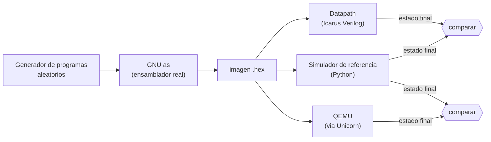

# Programs & Tools

## Programa de referencia

### Qué es y para qué sirve

El programa de referencia es un programa corto en ensamblador RISC-V cuyos resultados se pueden calcular a mano. Se ejecuta sobre el datapath no segmentado y deja valores conocidos en registros y en memoria de datos.

Cumple dos funciones:

1. **Prueba de integración del datapath.** Las pruebas por instrucción verifican cada operación por separado. Este programa verifica que **trabajen juntas** en secuencias reales: lazos, llamadas a función, accesos a memoria que dependen de resultados anteriores.
2. **Referencia para el pipeline.** El estado final que produce este modelo es el que debe reproducir el pipeline de cinco etapas. Cualquier diferencia indica un error en el manejo de riesgos.

---

### Archivos

| Archivo | Descripción |
| --- | --- |
| `programs/reference_program.s` | Programa en ensamblador, comentado |
| `programs/build_program.sh` | Ensambla un `.s` y genera el `.hex` y el listado |
| `programs/reference_program.hex` | Imagen lista para cargar: 54 palabras de 32 bits, una por línea |
| `programs/reference_program.lst` | Desensamblado de la imagen, para revisar la codificación |
| `tb/tb_reference_program.v` | Testbench que ejecuta el programa y compara el resultado |

**Generar la imagen** (requiere las binutils de RISC-V):

```bash
./programs/build_program.sh programs/reference_program.s
```

**Ejecutar la prueba**, desde la carpeta raíz del proyecto:

```bash
./run_tests.sh tb_reference_program
```

La instrucción `HALT` se escribe como la macro `halt`, que emite la palabra `0x0000000B`. El ensamblador estándar no la conoce, así que el programa define la macro al comienzo.

---

### Qué calcula el programa

El programa se divide en seis secciones independientes. Cada una trabaja con registros propios para que los resultados finales no se pisen entre sí.

| Sección | Qué hace | Resultado |
| --- | --- | --- |
| **A. Aritmética y lógica** | Opera con 10 y 3 usando `add`, `sub`, `and`, `or`, `xor`, `sll`, `srl` | Valores en `x4` a `x10` |
| **B. Suma con lazo** | Calcula 1 + 2 + … + 10 con un lazo armado con `beq` y `jal` | 55 en `x12` y en memoria |
| **C. Fibonacci** | Escribe los 10 primeros números de Fibonacci en memoria con un lazo `bne` | 0, 1, 1, 2, 3, 5, 8, 13, 21, 34 |
| **D. Llamada a función** | `jal` a una función que suma los 10 elementos del arreglo con `lw`, y vuelve con `jalr` | 88 en `x20` y en memoria |
| **E. Bytes y medias palabras** | Guarda `0x80FF7F01` con `lui` + `addi` y lo lee con `lb`, `lbu`, `lh`, `lhu`; después modifica un byte con `sb` | Ver tabla de resultados |
| **F. Con signo y sin signo** | Compara y desplaza el valor −16 con `sra`, `sltu` y `slt` | Ver tabla de resultados |

La función `sum_array` está al final del programa, después de `HALT`. Solo se llega a ella mediante la llamada de la sección D, y esa llamada se resuelve con un `jal` hacia adelante y un `jalr` de retorno.

El programa usa 23 mnemónicos distintos, todos de la lista obligatoria, más la palabra de `halt`. Las instrucciones que no aparecen (`andi`, `ori`, `xori`, `slti`, `sltiu`, `slli`, `srli` y `srai`) están cubiertas por las pruebas por instrucción.

---

### Resultados esperados

Todos los valores se calcularon a mano, sin ejecutar el programa.

#### Registros

| Registro | Valor | Origen |
| --- | --- | --- |
| `x0` | `0x00000000` | Siempre cero |
| `x1` | `0x00000078` | Dirección de retorno de la llamada (instrucción siguiente al `jal` en `0x74`) |
| `x2` | `10` | Operando de la sección A |
| `x3` | `3` | Operando de la sección A |
| `x4` | `13` | 10 + 3 |
| `x5` | `7` | 10 − 3 |
| `x6` | `2` | `1010 & 0011` |
| `x7` | `11` | `1010 \| 0011` |
| `x8` | `9` | `1010 ^ 0011` |
| `x9` | `80` | 10 << 3 |
| `x10` | `1` | 10 >> 3 |
| `x11` | `0` | Contador del lazo de suma, agotado |
| `x12` | `55` | Suma 1 + … + 10 |
| `x13` | `55` | fib(10), siguiente valor tras el último guardado |
| `x14` | `89` | fib(11) |
| `x15` | `40` | Puntero final: 10 elementos × 4 bytes |
| `x16` | `0` | Elementos restantes |
| `x17` | `89` | Último valor calculado en el lazo |
| `x18` | `40` | Puntero final de `sum_array` |
| `x19` | `0` | Contador de `sum_array`, agotado |
| `x20` | `88` | Suma de los 10 números de Fibonacci |
| `x21` | `34` | Último elemento leído (fib(9)) |
| `x22` | `0x80FF7F01` | `lui 0x80FF8` + `addi −255` |
| `x23` | `0xFFFFFFFE` | −16 >> 3 aritmético = −2 |
| `x24` | `1` | `sltu`: 10 < 0xFFFFFFF0 sin signo |
| `x25` | `0xFFFFFF80` | `lb` del byte `0x80` (con signo) |
| `x26` | `0x00000080` | `lbu` del mismo byte (sin signo) |
| `x27` | `0xFFFF80FF` | `lh` de la mitad alta (con signo) |
| `x28` | `0x000080FF` | `lhu` de la mitad alta (sin signo) |
| `x29` | `0xFFFFFFF0` | −16 |
| `x30` | `0x80FF5501` | Palabra leída después de `sb` |
| `x31` | `0` | `slt`: 10 < −16 con signo es falso |

`x31` pasa por `0x55` (valor guardado con `sb`) antes de recibir el resultado de `slt`, de modo que el `0` final prueba que la instrucción escribió el registro y no que quedó el valor inicial.

#### Memoria de datos

| Palabra | Dirección (bytes) | Valor | Contenido |
| --- | --- | --- | --- |
| 0 – 9 | `0x00` – `0x24` | 0, 1, 1, 2, 3, 5, 8, 13, 21, 34 | Fibonacci |
| 10 – 15 | `0x28` – `0x3C` | 0 | No deben haberse escrito |
| 16 | `0x40` | 55 | Suma 1 + … + 10 |
| 17 | `0x44` | 88 | Suma de los elementos de Fibonacci |
| 18 | `0x48` | `0x80FF5501` | Palabra de prueba con el byte 1 reemplazado (`0x7F` → `0x55`) |
| 19 | `0x4C` | 0 | No debe haberse escrito |

El testbench también verifica las palabras que **no** deben cambiar, para detectar escrituras de más.

#### Resumen de la ejecución

| Dato | Valor esperado | Cálculo |
| --- | --- | --- |
| PC al detenerse | `0x000000B8` | `HALT` está en la palabra 46 |
| Instrucciones completadas | 198 | A: 9 · B: 44 · C: 74 · D: 56 · E: 11 · F: 4 |
| Ciclos hasta `HALT` | 213 | 198 instrucciones + 15 ciclos de espera (cada load usa 2 ciclos: 5 en la sección E y 10 en `sum_array`) |
| Indicadores de error | Ninguno | Sin instrucciones ilegales, accesos fuera de rango ni desalineados |

---

### Resultado de la verificación

El programa se ejecutó sobre el datapath no segmentado y **todos los valores coinciden con los calculados a mano**, incluidos el PC final, la cantidad de instrucciones y la cantidad de ciclos.

También se comprobó que la prueba es sensible a defectos del diseño. Por ejemplo, inyectando un `sltu` implementado como `slt`, o un load que tarda un ciclo en lugar de dos, el testbench del programa de referencia falla.

---

### Uso en las etapas siguientes

- **Pipeline (E3).** Debe terminar con los mismos registros y la misma memoria. Cambian los ciclos, porque aparecen los stalls de load-use y las penalizaciones de los saltos tomados; este programa los ejercita: `sum_array` tiene un `lw` seguido de un `add` que lo usa, y los lazos tienen saltos tomados en cada iteración.
- **Debug Unit y PC (E5 y E6).** Sirve como programa de demostración repetible: se carga por UART, se ejecuta en modo continuo o paso a paso y se comparan los registros y la memoria que informa la FPGA con las tablas de este documento.
- **Herramienta de traducción (E6).** El archivo `.hex` sirve de referencia para comparar la salida del script que prepara la imagen.

## Comparación con un simulador de referencia

### Qué se verifica y por qué

Las pruebas anteriores comparan el datapath con valores que calculamos a mano. Eso es preciso, pero limitado: solo cubre los casos que se nos ocurrieron. Esta etapa agrega una comparación **automática contra un simulador independiente**, que permite probar miles de programas distintos sin calcular ningún resultado a mano.

La idea es simple: se ejecuta el mismo programa en el datapath y en un simulador de referencia, y se compara el estado final. Si difieren, uno de los dos tiene un error.

### Cómo se arma la verificación

Hay tres piezas, y cada una verifica a la anterior:



| Comparación | Qué demuestra |
| --- | --- |
| **Datapath contra simulador de referencia** | El diseño en Verilog hace lo mismo que el modelo de referencia |
| **Simulador de referencia contra QEMU** | El modelo de referencia es correcto según un emulador RISC-V ajeno al proyecto |
| **Valores calculados a mano** (programa de referencia) | Los resultados concretos coinciden con el cálculo manual |

Si solo se comparara el datapath con un simulador escrito por el mismo equipo, un error de interpretación de la ISA podría repetirse en ambos. Por eso el simulador de referencia se valida a su vez contra QEMU.

### Herramientas

| Archivo | Función |
| --- | --- |
| `tools/rv32i_ref.py` | Simulador de referencia RV32I en Python |
| `tools/gen_random_program.py` | Generador de programas aleatorios válidos y finitos |
| `tools/compare_with_reference.py` | Compara el datapath con el simulador de referencia |
| `tools/validate_reference_with_unicorn.py` | Compara el simulador de referencia con QEMU |
| `tb/tb_dump_state.v` | Ejecuta un programa en el datapath e imprime el estado final |

#### Simulador de referencia

Ejecuta una imagen de programa instrucción por instrucción, con las mismas reglas que el procesador del proyecto:

- Memoria de programa y de datos separadas.
- `HALT` como palabra `0x0000000B`.
- Instrucciones ilegales neutralizadas (no escriben ni saltan).
- Store fuera de rango suprimido, load fuera de rango devuelve 0.
- Acceso desalineado alineado hacia abajo.

Imprime el estado final: motivo de detención, PC, instrucciones completadas, ciclos, indicadores de error, los 32 registros y las 1024 palabras de memoria de datos. El mismo formato lo produce `tb_dump_state.v` desde el datapath, de modo que los dos resultados se comparan línea a línea.

```bash
python3 tools/rv32i_ref.py programs/reference_program.hex
```

#### Generador de programas aleatorios

Produce programas en ensamblador que siempre son válidos y terminan:

- Usan únicamente las instrucciones de la lista obligatoria y terminan en `HALT`.
- No producen accesos fuera de rango, desalineados ni instrucciones ilegales.
- Los saltos son hacia adelante, salvo lazos acotados de 2 a 5 iteraciones.
- Incluyen valores límite (`0`, `-1`, `0x80000000`, `0x7FFFFFFF`) mezclados con valores al azar.
- Los loads y stores comparten un conjunto pequeño de palabras de datos, para que los loads lean datos escritos antes y no solo ceros.
- `jalr` se prueba con un patrón que no necesita direcciones absolutas: un `jal` deja su dirección en un registro y el `jalr` salta relativo a ella, con desplazamiento par o impar para ejercitar la limpieza del bit 0.

Se genera a partir de una **semilla**, así que cualquier programa que falle se puede reproducir.

### Cómo ejecutarlo

Desde la carpeta raíz del proyecto (con `rtl/`, `tb/`, `programs/` y `tools/`):

```bash
# Un programa concreto
python3 tools/compare_with_reference.py program programs/reference_program.hex

# Programas aleatorios: datapath contra simulador de referencia
python3 tools/compare_with_reference.py random --count 1000 --seed 1 --blocks 80

# Simulador de referencia contra QEMU
python3 tools/validate_reference_with_unicorn.py --count 500 --seed 1
```

Requiere Icarus Verilog, las binutils de RISC-V (`riscv64-unknown-elf-as`) y, para la validación contra QEMU, la biblioteca de Python `unicorn` (`pip install unicorn`). Las rutas se pueden cambiar con `--rtl-dir`, `--tb-dir`, `--programs-dir` y `--build-dir`.

Cuando hay una diferencia, el comparador indica la semilla, conserva el programa que la provocó y muestra los valores de ambos lados:

```text
[DIFF] semilla 17: 3 diferencias
         REG 9: referencia = 80000000, datapath = 00000001
```

#### Qué se compara

| Dato | Comparación |
| --- | --- |
| Motivo de detención | `HALT` en ambos |
| PC final | Igual |
| Registros `x0` a `x31` | Iguales |
| Memoria de datos (1024 palabras) | Igual |
| Indicadores de ilegal, fuera de rango y desalineado | Iguales |
| Instrucciones completadas | Igual |
| Ciclos | Igual (ver nota abajo) |

**Sobre los ciclos.** Los ciclos de este modelo son `instrucciones + loads`, porque cada load usa dos ciclos. Es una propiedad del datapath no segmentado. En el pipeline los ciclos serán distintos (hay stalls y flushes), y se comparará con la opción `--no-cycles`.

### Resultados

| Comparación | Programas | Resultado |
| --- | --- | --- |
| Programa de referencia: datapath contra simulador | 1 | Coinciden en todo |
| Datapath contra simulador de referencia (aleatorios, 80 bloques) | 2000 | Todos coinciden |
| Simulador de referencia contra QEMU (aleatorios, 80 bloques) | 500 | Todos coinciden |

Los programas aleatorios usaron las 32 instrucciones de la lista obligatoria.

El simulador de referencia también reproduce los valores calculados a mano del programa de referencia: `x1 = 0x78`, `x12 = 55`, `x20 = 88`, 198 instrucciones y 213 ciclos.

### Validación de la propia herramienta

Una comparación que siempre da "coincide" no demuestra nada. Para comprobar que esta herramienta detecta errores se introdujeron 15 defectos distintos en copias del RTL, uno por vez, y se corrió la comparación con 40 programas:

| Defecto introducido | Programas que lo detectaron (de 40) |
| --- | --- |
| `bne` tratado como `beq` | 40 |
| `jal` guarda `pc` en lugar de `pc + 4` | 40 |
| Bits del inmediato B mal ordenados | 40 |
| Load sin ciclo de espera | 40 |
| Escritura en `x0` permitida | 35 |
| `sw` escribe solo 2 bytes | 35 |
| `jalr` sin limpiar el bit 0 | 28 a 34 |
| `sb` siempre escribe el byte 0 | 32 |
| `sltu` implementado como `slt` | 21 a 22 |
| `sh` siempre escribe la mitad baja | 19 |
| `lb` ignora el desplazamiento de byte | 18 |
| `lh` sin extensión de signo | 13 |
| `lb` sin extensión de signo | 9 |
| `lbu` con extensión de signo | 7 |
| `sra` implementado como desplazamiento lógico | 6 a 8 |

**Una debilidad encontrada y corregida.** En la primera versión, el defecto "`lb` sin extensión de signo" **no fue detectado**. La causa estaba en el generador: los loads leían direcciones al azar entre 256 palabras, que casi siempre estaban en cero, y con ceros la extensión de signo no se nota. Se corrigió haciendo que loads y stores compartan unas pocas palabras de datos. Con el generador corregido el defecto se detecta, y los defectos de signo en `lh` y `lbu` también.

### Alcance y limitaciones

- **QEMU no valida las reglas propias del proyecto.** Las políticas de instrucción ilegal, acceso fuera de rango y acceso desalineado son decisiones de este diseño (no las define la ISA), así que el simulador de referencia las implementa por su cuenta y los programas aleatorios las evitan. Esos casos están cubiertos por las pruebas por instrucción (`tb_load_store`).
- **El programa de referencia no corre en QEMU.** QEMU tiene una única memoria, y este programa guarda datos desde la dirección `0x00`, donde también está el código. Por eso se valida con las tablas calculadas a mano, el simulador de referencia y el datapath, que coinciden entre sí. Los programas aleatorios sí corren en QEMU porque mantienen el código por debajo de `0x400` y los datos por encima.
- **Qué no cubren los programas aleatorios:** instrucciones ilegales, `HALT` en medio de un programa, fin de imagen por `N_WORDS` y saltos hacia atrás fuera de los lazos acotados.
- **Pruebas sin riesgos de pipeline.** Este modelo ejecuta una instrucción por vez; los programas aleatorios incluyen muchas dependencias entre instrucciones consecutivas, que son justamente las que el pipeline deberá resolver con forwarding y stalls.

### Uso en las etapas siguientes

- **Pipeline (E3).** Es el uso principal. El mismo comando, apuntando al RTL del pipeline y con `--no-cycles`, compara su estado final con el simulador de referencia en miles de programas con dependencias de datos, load-use y saltos.
- **Hardware (E7 y E8).** El simulador de referencia puede producir el estado esperado de cualquier programa, para compararlo con lo que informa la FPGA por UART.